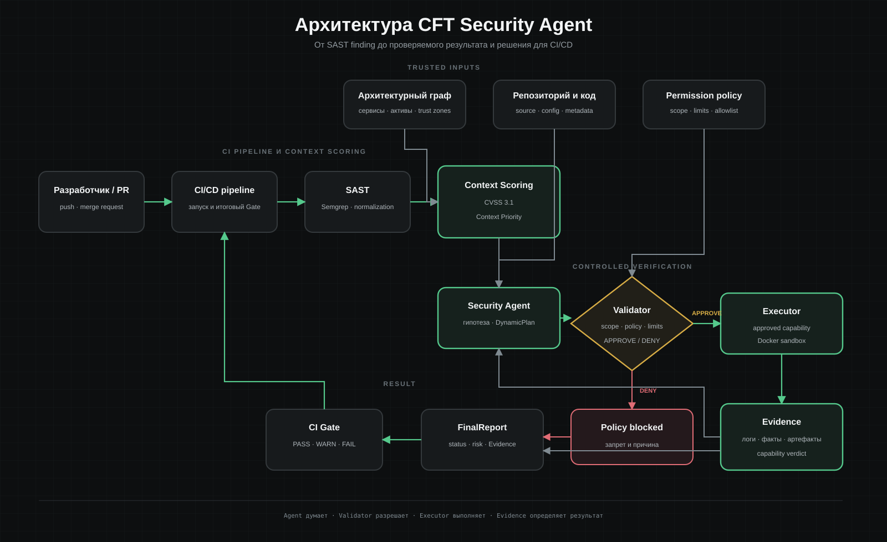
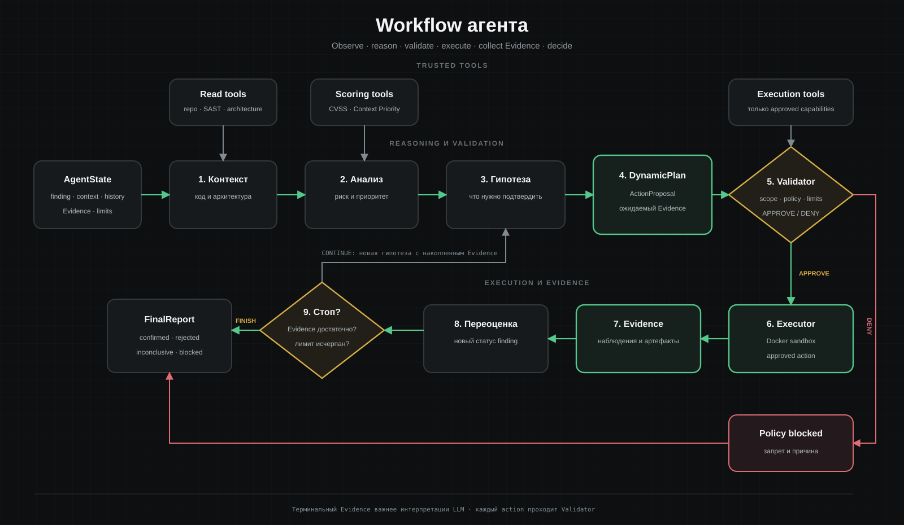

<div align="center">

# CFT Security Agent

Контекстный анализ, доказательная проверка и ограниченное исправление уязвимостей.

**Python · LangGraph · FastAPI · React · Semgrep · Docker**

[Запуск](#быстрый-запуск) · [Документация](docs/README.md) · [Метрики](docs/bespalov-metrics-with-scoring-2026-10-16.md) · [Разработка](CONTRIBUTING.md)

</div>


## Что это

Агент для анализа безопасности ПО в CI/CD. Он объединяет результаты сканеров,
исследование исходников и контролируемые проверки в изолированной лаборатории.
Итоговый вердикт связан с сохраненными доказательствами, а не только с ответом LLM.

> Агент думает. Validator разрешает. Executor выполняет. Evidence определяет результат.

Проект находится на стадии исследовательского MVP. Текущий поиск и проверка
специализированы под закрепленную версию OWASP Juice Shop. Есть интерфейс анализа
проектов, но результаты этого корпуса нельзя переносить на произвольный проект.

## Возможности и границы

| Направление | Что реализовано |
|---|---|
| Поиск | Discovery, Semgrep, целевые source-detectors и LLM-исследование исходников |
| Исследование | Чтение файлов, рабочая область, Python/Node-скрипты в Docker, разрешенные HTTP- и браузерные наблюдения |
| Проверка | Зарегистрированные протоколы с source/endpoint-привязкой, контролями, execution/audit и независимым разбором Evidence |
| Оценки | Раздельные CVSS 3.1 и Context Priority; неизвестные входы сохраняются, оценки не заменяют доказательства |
| Исправления | LLM-патчи и независимая BEFORE/AFTER-проверка для SQL-поиска и redirect allowlist; не универсальное автоисправление |
| CI/CD и UI | API, история запусков, действия и доказательства, FinalReport и детерминированный Gate |

Интерфейс запускает канонический pipeline. Расширенный research-контур и ремонтные
эксперименты включаются отдельно операторскими CLI/профилями; запуск UI их не активирует.

## Последнее опубликованное измерение

Один проход 16 октября 2026, Juice Shop **v20.2.0**, известный разработчикам
original-срез: **27 уязвимых и 8 безопасных случаев**.

| Показатель | Результат |
|---|---|
| Обнаружение уязвимых случаев | 27/27 |
| Precision подтверждений | 13/13 = 100% |
| Recall подтверждений | 13/27 = 48,15% |
| Проверенные исправления | 2/2 поддерживаемых случая |
| Среднее лабораторное время исправления | 80,986 с, n=2, без времени поиска |

Это не оценка на неизвестном holdout и не заявление о качестве на всех проектах.
Поиск завершился с ограничениями бюджета. Воспроизводимость не измерялась;
эксплуатационный MTTR отсутствует. Серьезность сопоставлена только на трех случаях,
а CP пока сравнен с модельным черновиком, требующим человеческой проверки.

[Все метрики и ограничения](docs/bespalov-metrics-with-scoring-2026-10-16.md) ·
[Состав прохода и архивы доказательств](docs/search-repair-integration-2026-10-16.md)

## Архитектура



Репозиторий и архитектурный контекст поступают в анализ. Агент предлагает действие;
Validator проверяет разрешения; Executor выполняет одобренное действие;
Evidence возвращается агенту и в финальный отчет. Gate передает результат в CI/CD.
Ни UI, ни LLM не обходят эту цепочку.



Границы исполнения:

- активные проверки только в разрешенной локальной/test-среде, не в production;
- каждая операция связана с одобрением и операторским scope;
- произвольные команды и исследовательские скрипты исполняются только в Docker;
- общие скрипты изолированы от сети; целевые запросы идут через доверенные capabilities;
- исходники, секреты, сетевые права и бюджеты не расширяются решением модели;
- `confirmed` требует доказательств, технический сбой не означает безопасный код.

Контракты и правила реализации: [AGENTS.md](AGENTS.md).

## Быстрый запуск

Для первого запуска используйте встроенный магазин: его исходники, правила и профили
уже входят в репозиторий. Отдельно скачивать SberLab или Juice Shop не нужно.

Нужны Git, Python **3.11–3.13**, Node.js **22.12+**, Docker с Compose v2 и действующий
ключ NSU с доступом к **Qwen3.8-27B**. Перед подготовкой запустите Docker Desktop.
В Windows выполняйте команды в **WSL2 (Ubuntu)** с включённой интеграцией Docker
Desktop; Python и Node.js установите внутри WSL. Нативный PowerShell для полного
прохода Semgrep в этой инструкции не используется.

### 1. Получить проект и зависимости

```bash
git clone https://github.com/Ultramind-AI/cft-security-agent.git
cd cft-security-agent
python3 -m venv .venv
source .venv/bin/activate
python -m pip install -c requirements-first-run.txt -e ".[dev,sast]"
npm --prefix frontend ci
cp .env.example .env
```

Команду копирования `.env` выполняйте только при первой установке. При обновлении
сохраните существующий файл. `requirements-first-run.txt` закрепляет проверенные
Python-зависимости, `frontend/package-lock.json` — зависимости интерфейса.

### 2. Указать ключ и подготовить Docker

Откройте `.env` любым текстовым редактором и заполните одну строку:

```dotenv
NSU_OPENWEBUI_KEY=ваш-действующий-ключ
```

После сохранения:

```bash
python -m app.setup --prepare-demo
```

Команда проверит инструменты и ответ живой модели, загрузит образ исполнителя,
сохранит его неизменяемый SHA-256 в `.env` и соберёт демонстрационный магазин.
На первом запуске загрузка образов может занять несколько минут. Ключ не выводится
и не передаётся магазину. Повторная подготовка сохраняет остальные настройки `.env`.

### 3. Запустить сервер и интерфейс

В первом терминале из корня проекта с активной `.venv`:

```bash
python -m app.demo
```

Дождитесь сообщения `Uvicorn running on http://127.0.0.1:8080`.
Во втором терминале из каталога проекта:

```bash
npm --prefix frontend run dev -- --strictPort
```

Откройте <http://127.0.0.1:5173/demo/order-store> и нажмите **«Запустить проверку»**.
Ссылка **«Открыть действия и доказательства»** показывает текущие шаги, реальные
команды и результаты, а после завершения — все уникальные находки и итоговый отчёт.
Для диалога выберите магазин в разделе «Проекты» и отправьте запрос на анализ.
Встроенный магазин использует вымышленные данные и доступен только локально.

API: <http://127.0.0.1:8080/docs>. Магазин: <http://127.0.0.1:8090>.
Закрывайте сервер через Ctrl+C: это штатно останавливает его предпросмотр.

### Если запуск не удался

```bash
python -m app.setup --check-model
```

Проверка назовёт недостающую зависимость, занятой порт, недоступный Docker,
неподготовленный образ или проблему ключа/модели до начала анализа.
Если порты заняты другой установкой, используйте отдельные порты и хранилище:

```bash
python -m app.demo --port 8082 --preview-port 8091 --data-dir api_data/isolated-demo
```

В `frontend/.env.local` запишите `CFT_UI_API_PROXY=http://127.0.0.1:8082`, затем
запустите `npm --prefix frontend run dev -- --port 5174 --strictPort` и откройте
<http://127.0.0.1:5174/demo/order-store>. Кнопка и встроенное окно магазина используют
адрес, сообщённый этим сервером.

### Анализ других проектов

`cft-security-api` запускает общий API с зарегистрированными оператором профилями
и импортом проектов. Для него нужно отдельно подготовить целевой проект и
разрешённые проверки; сам запуск API лабораторию не создаёт. Демо выше — готовый
первый сквозной сценарий. Расширенный исследовательский контур и исправления
настраиваются по соответствующей документации, а не включаются автоматически.

По умолчанию общий API использует `stub` для проверки интеграции без API-ключа.
Для живого поиска задайте `CFT_AGENT_MODE=llm` и `CFT_LLM_ROUTES` в `.env`.
Демонстрационный сервер сам выбирает Qwen3.8-27B и ограниченный живой проход.

## CLI и лаборатория

Минимальная проверка графа без target и API-ключа:

```bash
python -m app.main
```

CI-проход на отдельно подготовленном SberLab:

```bash
cft-security-ci \
  --target ../sberlab-target \
  --profile targets/sberlab.yaml \
  --output-dir artifacts/security-pipeline \
  --agent-mode stub \
  --max-iterations 1
```

Коды выхода: `0` — Gate не блокирует CI; `1` — завершенный security/policy FAIL;
`2` — техническая ошибка. Повторные запуски сохраняйте в новых каталогах.

- [Подготовка закрепленного окружения](docs/k01-environment-passport.md).
- [Исследовательский цикл](docs/research-loop-r04.md).
- [Совместный поиск и проверенные исправления](docs/search-repair-integration-2026-10-16.md).
- [Независимая проверка патчей](docs/c03-independent-patch-verification.md).

## Структура репозитория

| Каталоги | Назначение |
|---|---|
| `agent/`, `schemas/` | Reasoning, LangGraph и общие контракты |
| `app/`, `api/`, `pipeline/` | CLI, API, оркестрация, Gate и жизненный цикл |
| `discovery/`, `sast/`, `architecture/`, `scoring/` | Поиск и контекстные оценки |
| `validator/`, `security/`, `policies/`, `targets/` | Разрешения, доверенные привязки и профили |
| `executor/`, `tools/`, `evidence/`, `reporting/` | Исполнение, доказательства и отчеты |
| `fix_verification/`, `contracts/` | Проверка исправлений и защищенные контракты |
| `evaluation/`, `benchmarks/` | Оценщики, замороженный эталон и контроли |
| `frontend/`, `tests/` | Интерфейс и тесты |
| `docs/`, `artifacts/` | Документация и опубликованные доказательства |

Локальные `.env`, окружения, кэши, runtime-данные и новые артефакты игнорируются Git.
Опубликованные архивы в `artifacts/` нужны для независимой проверки результатов.

## Разработка

```bash
python -m pytest -q
python -m ruff check .
python -m app.main

cd frontend
npm test
npm run build
```

Docker/live-проверки включаются отдельно и могут быть пропущены без закрепленной
лаборатории. Пропуски нужно учитывать, а не считать успешными проверками.

