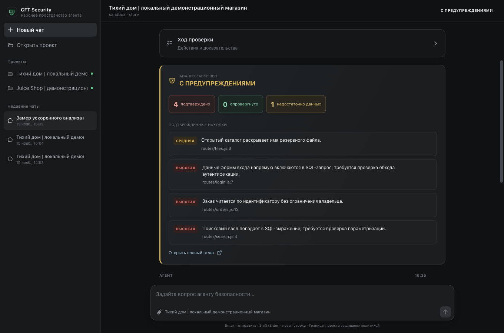

# CFT Security Agent

ИИ-агент для поиска и проверки уязвимостей в CI/CD. Откройте проект в чате,
запустите анализ и получите находки с файлами, выполненными командами и доказательствами.

[Быстрый запуск](#быстрый-запуск) · [Работа в чате](#работа-в-чате) · [CLI](#cli) · [CI/CD](#cicd) · [Документация](docs/README.md)



## Как это работает

1. **Находит кандидатов.** Изучает структуру проекта и исходники, запускает Semgrep.
2. **Проверяет.** Модель предлагает действия; валидатор проверяет разрешения,
   исполнитель запускает одобренные проверки в изолированной Docker-среде.
3. **Объясняет результат.** Сохраняет доказательства, формирует отчет и решение для CI/CD.
   Серьезность и контекстный приоритет оцениваются раздельно.

Работа через чат, CLI и CI/CD использует общий pipeline. Подтверждение требует
доказательств; ответа модели или совпадения с правилом сканера недостаточно.
Автоматическая проверка зависит от подключенных протоколов: для незнакомого
проекта часть находок может остаться со статусом «Недостаточно данных».

## Быстрый запуск

Начните со встроенного учебного магазина. Он входит в репозиторий: скачивать
SberLab, Juice Shop и результаты старых запусков не нужно.

### Что установить заранее

| Нужно | Как проверить |
|---|---|
| Git | `git --version` |
| Доступ к этому закрытому GitHub-репозиторию | Ваш аккаунт добавлен в проект |
| Python 3.11 | `python3.11 --version` |
| Node.js 22.12 или новее | `node --version` |
| npm | `npm --version` |
| Docker с Compose v2 | `docker version` и `docker compose version` |
| Собственный действующий ключ NSU | Доступ к модели `Qwen3.8-27B` |

Рекомендуем Python **3.11**: на нем проверена чистая установка с закрепленными
зависимостями. Запустите Docker Desktop и дождитесь готовности Docker Engine.
На Linux подойдет Docker Engine с Compose v2.

**Windows:** выполняйте команды внутри WSL2, например Ubuntu, и включите для
этого дистрибутива интеграцию Docker Desktop. Git, Python и Node.js установите
внутри WSL. Команды ниже рассчитаны на bash/zsh, а не PowerShell.

### 1. Скачать и установить

Если Git еще не авторизован в GitHub, установите [GitHub CLI](https://cli.github.com/)
и выполните `gh auth login`, затем `gh auth setup-git --hostname github.com`. Используйте аккаунт,
которому выдан доступ. Ошибка `Repository not found` при клонировании может
означать отсутствие доступа, а не неверный адрес.

Откройте терминал в каталоге, где хотите хранить проект:

```bash
git clone https://github.com/Ultramind-AI/cft-security-agent.git
cd cft-security-agent
python3.11 -m venv .venv
source .venv/bin/activate
python -m pip install -c requirements-first-run.txt -e ".[dev,sast]"
npm --prefix frontend ci
cp .env.example .env
```

Все следующие команды выполняйте **из корня `cft-security-agent`**.
Активация `.venv` нужна в каждом новом терминале с Python-командами.

### 2. Указать ключ

Откройте файл `.env` в редакторе и заполните строку:

```dotenv
NSU_OPENWEBUI_KEY=ваш-действующий-ключ
```

Остальные поля для первого запуска менять не нужно. Ключ остается в локальном
`.env`; этот файл исключен из Git. Значение `CFT_AGENT_MODE=stub` в шаблоне не
мешает: сервер `app.demo` запускает анализ чата с живой моделью.

### 3. Подготовить окружение

```bash
python -m app.setup --prepare-demo
```

Команда проверит инструменты и ответ модели, загрузит Docker-образ исполнителя,
закрепит его SHA-256 в `.env` и соберет учебный магазин.
Дождитесь сообщения **«Готово»**. Первая загрузка может занять несколько минут;
дальше образы используются повторно.

### 4. Запустить два процесса

**Терминал 1**, с активной `.venv`:

```bash
python -m app.demo
```

Дождитесь `Uvicorn running on http://127.0.0.1:8080`.

**Терминал 2**, в том же каталоге проекта:

```bash
npm --prefix frontend run dev -- --strictPort
```

Откройте **[http://127.0.0.1:5173](http://127.0.0.1:5173)**.
Оба терминала должны оставаться открытыми. Для остановки нажмите Ctrl+C
в каждом из них; сервер также остановит свой контейнер предпросмотра.

## Работа в чате

1. В разделе **«Проекты»** слева выберите **«Тихий дом»**. Откроется новый чат.
2. Отправьте: **«Проведи полный анализ безопасности проекта»**.
3. Раскройте **«Ход проверки»**: там появляются этапы, команды и доказательства.
4. После завершения откройте карточки находок или **«Открыть полный отчет»**.
5. Задайте вопрос: **«В каких файлах найдены проблемы и как их исправить?»**.

В проверенном локальном запуске анализ магазина занял около минуты. На время
влияют Docker, сеть и очередь модели; это ориентир, а не тайм-аут.
Учебный магазин содержит четыре зарегистрированных сценария проверки.
Дополнительные наблюдения модели могут остаться неподтвержденными.

Для своего проекта нажмите **«Открыть проект»** и выберите папку или ZIP.
Архив должен содержать исходники и файлы запуска: например, Dockerfile/Compose
и манифесты зависимостей. Внешние базы, секреты и специальные runtime-проверки
нужно настраивать отдельно. [Подключение проекта и границы анализа](docs/usage/cli-and-ci.md#свой-проект).

В основной панели оставлены проекты и чаты. Действия, доказательства и отчеты
открываются из диалога; отдельные демонстрационные разделы не нужны для работы.

## CLI

После установки и подготовки окружения сервер и интерфейс можно не запускать:

```bash
python -m app.demo_check --output-dir artifacts/demo-cli
```

Это тот же быстрый сценарий магазина, с живой моделью и настоящими проверками.
Результат появится в терминале, полные данные — в `artifacts/demo-cli`.
Для повторного запуска укажите **новый** каталог: старые доказательства не перезаписываются.

```bash
python -m json.tool artifacts/demo-cli/gate.json
```

| Файл / каталог | Содержимое |
|---|---|
| `gate.json` | Общее решение, счетчики и причины |
| `reports/` | Отдельные отчеты по находкам |
| `evidence/` и `audit/` | Результаты проверок и журнал исполнения |
| `progress.jsonl` | События выполнения |
| `ci-summary.json` | Состояние полного pipeline |

Для подключенных проектов есть `cft-security-ci` — с управлением Docker-средой,
и `cft-security-pipeline` — без управления запуском приложения.
[Команды, параметры, PR-анализ и примеры](docs/usage/cli-and-ci.md).

## CI/CD

Агент возвращает код завершения, который может использовать сборка:

| Код | Значение |
|---|---|
| `0` | Проверка завершена: `pass` либо `warn`; смотрите `gate.json` |
| `1` | Проверка завершена, подтвержденный риск блокирует сборку |
| `2` | Техническая ошибка; заключение о безопасности не получено |

**Проверить интеграцию локально без ключа модели:**

```bash
python -m app.demo_check --agent-mode stub --output-dir artifacts/ci-smoke
python -m json.tool artifacts/ci-smoke/gate.json
```

В режиме `stub` запускаются Docker, Semgrep, граф агента и сохранение отчетов,
но LLM не вызывается. Зарегистрированные проверки магазина работают по фиксированным
протоколам и получают настоящие доказательства. Для него ожидаются `warn`,
четыре подтверждения и ноль технических ошибок. Это проверка интеграции и
протоколов, **не измерение качества поиска языковой модели**.

В GitHub откройте **Actions → Quickstart check → Run workflow**.
[Этот workflow](.github/workflows/quickstart-check.yml) запускает тесты,
собирает интерфейс, выполняет такой же CI-smoke и прикладывает результаты
как `quickstart-ci-smoke`. NSU-ключ и внешние тестовые репозитории ему не нужны.

Для анализа своего проекта из GitHub Actions или другого CI используйте
[инструкцию CI/CD](docs/usage/cli-and-ci.md#подключение-к-cicd).

## Если что-то не запускается

| Симптом | Что сделать |
|---|---|
| `python` или `semgrep` не найден | Активируйте `.venv`; проверьте установку из шага 1 |
| Docker недоступен | Запустите Docker Desktop; убедитесь, что `docker version` показывает Server |
| `401` / `403`, модель не отвечает | Проверьте свой NSU-ключ и выполните команду ниже |
| Образ проверок не подготовлен | Повторите `python -m app.setup --prepare-demo` |
| Порт занят | Остановите прежний процесс или [выберите другие порты](docs/usage/cli-and-ci.md#другие-порты) |
| `--output-dir` уже содержит данные | Укажите новый каталог, например `artifacts/demo-cli-2` |
| В CLI код `1` | Откройте `gate.json`: это может быть найденный риск, а не падение |

Проверка инструментов, Docker, портов и модели:

```bash
python -m app.setup --check-model
```

Выполняйте ее при остановленном сервере: его занятые порты будут отмечены как занятые.
При обновлении проекта сохраняйте свой `.env`; повторное `cp .env.example .env`
сотрет локальные настройки.

## Документация

- [CLI, подключение проекта, CI/CD и другие порты](docs/usage/cli-and-ci.md).
- [Архитектура системы](docs/diagrams/architecture.svg) и [цикл агента](docs/diagrams/workflow.svg).
- [Контракты и границы безопасности](AGENTS.md).
- [Результаты измерений и ограничения](docs/bespalov-metrics-with-scoring-2026-10-16.md).
- [Каталог технической документации](docs/README.md).

Проект — исследовательский MVP. Расширенные проверки и автоматические исправления
подключаются отдельными профилями; универсальное автоматическое исправление
любой уязвимости не заявляется. Активные проверки предназначены для согласованных
локальных и тестовых сред, а не production.
