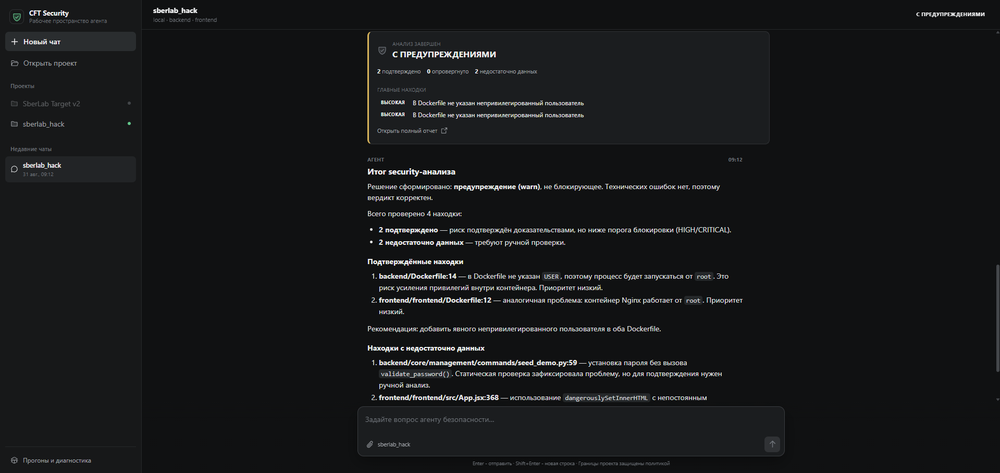

<div align="center">

# CFT Security Agent

Контекстный анализ, доказательная проверка и ограниченное исправление уязвимостей.

**Python · LangGraph · FastAPI · React · Semgrep · Docker**

[Запуск](#быстрый-запуск) · [Документация](docs/README.md) · [Метрики](docs/bespalov-metrics-with-scoring-2026-10-16.md) · [Разработка](CONTRIBUTING.md)

</div>



## Что это

Агент для анализа безопасности ПО в CI/CD. Он объединяет результаты сканеров,
исследование исходников и контролируемые проверки в изолированной лаборатории.
Итоговый вердикт связан с сохраненными доказательствами, а не только с ответом LLM.

> Агент думает. Validator разрешает. Executor выполняет. Evidence определяет результат.

Проект находится на стадии исследовательского MVP. Текущий поиск и проверка
специализированы под закрепленную версию OWASP Juice Shop. Есть интерфейс анализа
проектов, но результаты этого корпуса нельзя переносить на произвольный проект.

## Возможности и границы

| Направление | Что реализовано |
|---|---|
| Поиск | Discovery, Semgrep, целевые source-detectors и LLM-исследование исходников |
| Исследование | Чтение файлов, рабочая область, Python/Node-скрипты в Docker, разрешенные HTTP- и браузерные наблюдения |
| Проверка | Зарегистрированные протоколы с source/endpoint-привязкой, контролями, execution/audit и независимым разбором Evidence |
| Оценки | Раздельные CVSS и Context Priority; неизвестные входы сохраняются, оценки не заменяют доказательства |
| Исправления | LLM-патчи и независимая BEFORE/AFTER-проверка для SQL-поиска и redirect allowlist; не универсальное автоисправление |
| CI/CD и UI | API, история запусков, действия и доказательства, FinalReport и детерминированный Gate |

Интерфейс запускает канонический pipeline. Расширенный research-контур и ремонтные
эксперименты включаются отдельно операторскими CLI/профилями; запуск UI их не активирует.

## Последнее опубликованное измерение

Один проход 16 октября 2026, Juice Shop **v20.2.0**, известный разработчикам
original-срез: **27 уязвимых и 8 безопасных случаев**.

| Показатель | Результат |
|---|---|
| Обнаружение уязвимых случаев | 27/27 |
| Precision подтверждений | 13/13 = 100% |
| Recall подтверждений | 13/27 = 48,15% |
| Проверенные исправления | 2/2 поддерживаемых случая |
| Среднее лабораторное время исправления | 80,986 с, n=2, без времени поиска |

Это не оценка на неизвестном holdout и не заявление о качестве на всех проектах.
Поиск завершился с ограничениями бюджета. Воспроизводимость не измерялась;
эксплуатационный MTTR отсутствует. Серьезность сопоставлена только на трех случаях,
а CP пока сравнен с модельным черновиком, требующим человеческой проверки.

[Все метрики и ограничения](docs/bespalov-metrics-with-scoring-2026-10-16.md) ·
[Состав прохода и архивы доказательств](docs/search-repair-integration-2026-10-16.md)

## Архитектура


Репозиторий и архитектурный контекст поступают в анализ. Агент предлагает действие;
Validator проверяет разрешения; Executor выполняет одобренное действие;
Evidence возвращается агенту и в финальный отчет. Gate передает результат в CI/CD.
Ни UI, ни LLM не обходят эту цепочку.


Границы исполнения:

- активные проверки только в разрешенной локальной/test-среде, не в production;
- каждая операция связана с одобрением и операторским scope;
- произвольные команды и исследовательские скрипты исполняются только в Docker;
- общие скрипты изолированы от сети; целевые запросы идут через доверенные capabilities;
- исходники, секреты, сетевые права и бюджеты не расширяются решением модели;
- `confirmed` требует доказательств, технический сбой не означает безопасный код.

Контракты и правила реализации: [AGENTS.md](AGENTS.md).

## Быстрый запуск

Нужны Python **3.11+**, Node.js **20.19+** и Git. Для активных проверок дополнительно
нужны Docker с Compose, подготовленный target и соответствующие образы.
Установка зависимостей сама по себе лабораторию не создает.

### 1. Backend

```bash
python3 -m venv .venv
source .venv/bin/activate
python -m pip install -e ".[dev,sast]"
cp .env.example .env
cft-security-api
```

В Windows используйте `python` вместо `python3`, активацию
`.venv\Scripts\Activate.ps1` и `Copy-Item .env.example .env`.

API: <http://127.0.0.1:8080> · OpenAPI: <http://127.0.0.1:8080/docs>.
Не перезаписывайте существующий `.env`: это локальная конфигурация, она не входит в Git.

### 2. Интерфейс

В другом терминале:

```bash
cd frontend
npm ci
npm run dev
```

Интерфейс: <http://127.0.0.1:5173>. Доступны импорт проекта, запуск анализа,
история, журнал действий, доказательства и итоговый отчет.

### 3. Режим модели

По умолчанию используется `stub`: детерминированная проверка интеграции без API-ключа,
не полноценный LLM-поиск. Для живой модели настройте локальный `.env`:

```dotenv
CFT_AGENT_MODE=llm
NSU_OPENWEBUI_KEY=your-local-key
CFT_LLM_TRACE=false
```

Маршруты задаются через `CFT_LLM_ROUTES`; встроенная NSU-цепочка описана в
[.env.example](.env.example). Внешние fallback-провайдеры включаются только явно.
Ключи не коммитятся и не передаются целевому приложению.

## CLI и лаборатория

Минимальная проверка графа без target и API-ключа:

```bash
python -m app.main
```

CI-проход на отдельно подготовленном SberLab:

```bash
cft-security-ci \
  --target ../sberlab-target \
  --profile targets/sberlab.yaml \
  --output-dir artifacts/security-pipeline \
  --agent-mode stub \
  --max-iterations 1
```

Коды выхода: `0` — Gate не блокирует CI; `1` — завершенный security/policy FAIL;
`2` — техническая ошибка. Повторные запуски сохраняйте в новых каталогах.

- [Подготовка закрепленного окружения](docs/k01-environment-passport.md).
- [Исследовательский цикл](docs/research-loop-r04.md).
- [Совместный поиск и проверенные исправления](docs/search-repair-integration-2026-10-16.md).
- [Независимая проверка патчей](docs/c03-independent-patch-verification.md).

## Структура репозитория

| Каталоги | Назначение |
|---|---|
| `agent/`, `schemas/` | Reasoning, LangGraph и общие контракты |
| `app/`, `api/`, `pipeline/` | CLI, API, оркестрация, Gate и жизненный цикл |
| `discovery/`, `sast/`, `architecture/`, `scoring/` | Поиск и контекстные оценки |
| `validator/`, `security/`, `policies/`, `targets/` | Разрешения, доверенные привязки и профили |
| `executor/`, `tools/`, `evidence/`, `reporting/` | Исполнение, доказательства и отчеты |
| `fix_verification/`, `contracts/` | Проверка исправлений и защищенные контракты |
| `evaluation/`, `benchmarks/` | Оценщики, замороженный эталон и контроли |
| `frontend/`, `tests/` | Интерфейс и тесты |
| `docs/`, `artifacts/` | Документация и опубликованные доказательства |

Локальные `.env`, окружения, кэши, runtime-данные и новые артефакты игнорируются Git.
Опубликованные архивы в `artifacts/` нужны для независимой проверки результатов.

## Разработка

```bash
python -m pytest -q
python -m ruff check .
python -m app.main

cd frontend
npm test
npm run build
```

Docker/live-проверки включаются отдельно и могут быть пропущены без закрепленной
лаборатории. Пропуски нужно учитывать, а не считать успешными проверками.

[Правила участия](CONTRIBUTING.md) · [Каталог документации](docs/README.md)
