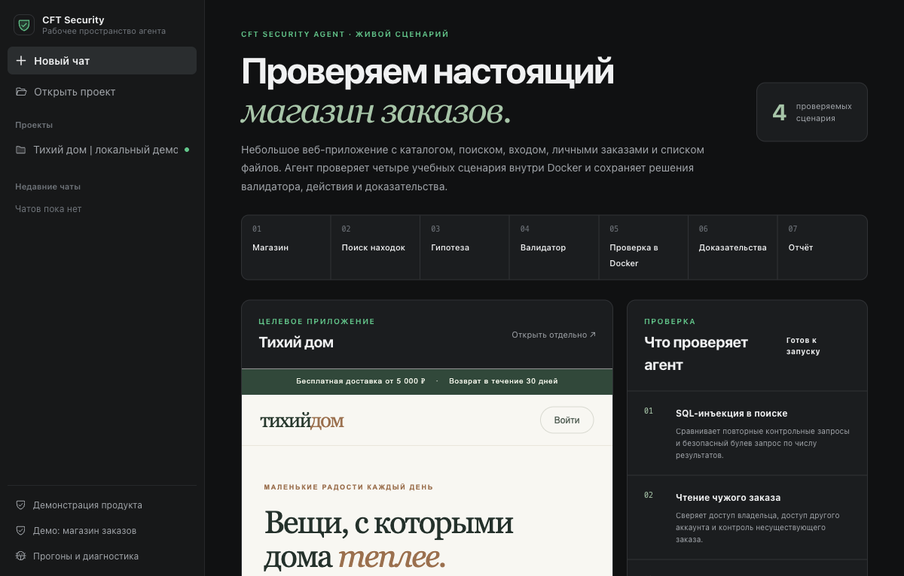
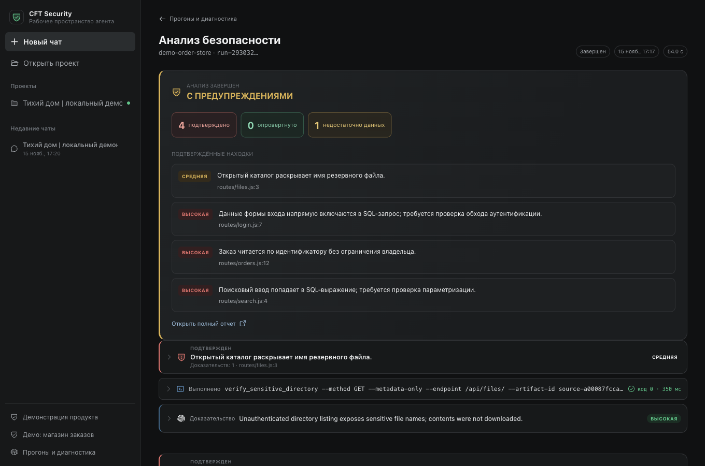

# Проверка первого запуска и интерфейса

Дата: 15 ноября 2026 года. Исходная версия: `fe2f11e`.
Исправления проверены в ветке `codex/first-run-ui-readiness`.

## Условия

Создана отдельная копия репозитория без `.env`, виртуального окружения,
`node_modules`, базы API и результатов прежних запусков. Python-зависимости
скачаны без pip-кэша, npm использовал новый каталог кэша. Затем оператор указал
действующий ключ NSU и выполнил подготовку, описанную в README.
Docker-демон и его общий кэш образов принадлежат тому же компьютеру; это не новый Mac.

Полный сценарий проверен на macOS 26.5.2 arm64, Python 3.11.9, Node.js 22.22.3,
Docker 28.5.2 и Compose 2.40.3. В чистом контейнере Debian 13 arm64 отдельно
прошли установка закреплённых зависимостей, `pip check`, граф и Semgrep 1.185.0.
Полный UI/Docker-проход в Linux и нативной Windows не выполнялся; для Windows
в README описан запуск через WSL2.

## Проверенные действия

| Действие | Результат |
|---|---|
| Установка Python и npm-зависимостей в чистой копии | Пройдена |
| Проверка ключа реальным запросом и подготовка образов | Пройдена |
| Открытие встроенного магазина в браузере | Пройдено |
| Нажатие «Запустить проверку», переход к действиям и доказательствам | Пройдено; 45,018 с |
| Создание чата выбором проекта и отправка анализа через UI | Пройдено |
| Финальный проход после исправлений | 54,005 с; 4 подтверждено, 1 недостаточно данных; 0 технических ошибок |
| Раскрытие реальных команд и структурированных доказательств | Пройдено |
| Сопоставление всех четырёх подтверждений с execution/audit | Пройдено |
| Перезагрузка страницы с сохранённым результатом | Пройдена |
| Уточняющий вопрос о файлах через UI | Получен ответ живой модели |
| Меню и ширина страницы на экране 390×844 | Пройдены; горизонтального переполнения нет |
| SIGTERM и повторный запуск на тех же портах | Пройден; собственный контейнер предпросмотра удаляется |

Запуски анализа инициированы кнопками/полем ввода в реальном браузере.
API и локальные файлы использованы дополнительно для независимой проверки
сохранённых результатов. В финальной стабильной браузерной сессии ошибок консоли нет.
Во время намеренных перезапусков ранее фиксировались ожидаемые ошибки соединения.

## Исправления

- README теперь описывает готовый первый сценарий, включая ключ и подготовку образов.
- Добавлены закреплённые Python-зависимости и `python -m app.setup --prepare-demo`.
- Проверки инструментов, образа, ключа и портов завершаются понятной причиной до анализа.
- У отдельных копий разные Compose-проекты, настраиваемые порты и хранилище.
- Очистка перенесена в lifespan API: она выполняется и с новой версией Uvicorn.
- Проверка порта учитывает `TIME_WAIT`, не принимая его за работающий сервер.
- Настройки чата согласованы с быстрым режимом демо, итог модели сохраняется в UI.
- Повторные наблюдения с пересекающимися диапазонами объединяются только при
  однозначной операторской привязке и одном соответствующем участке сканера.
- Исторические A03-тесты сохранены побайтно. Их внешняя зависимость от отдельно
  подготовленного Juice Shop объявлена в `tests/conftest.py`; пропуски не считаются успехом.

Проверки: в чистой копии **1796 passed, 82 skipped**; в рабочей копии с дополнительными
фикстурами **1846 passed, 32 skipped**; интерфейс **36 passed**, сборка и Ruff прошли.
Пропущены проверки, которым нужны отдельные исторические артефакты, закреплённый
Juice Shop/SberLab или явное включение интеграции.

[Машиночитаемая сводка и контрольные суммы](first-run-acceptance.json).
Полные локальные артефакты и трассы сохранены в каталоге проверки;
сводка не заменяет полный пакет для повторного расчёта метрик.

