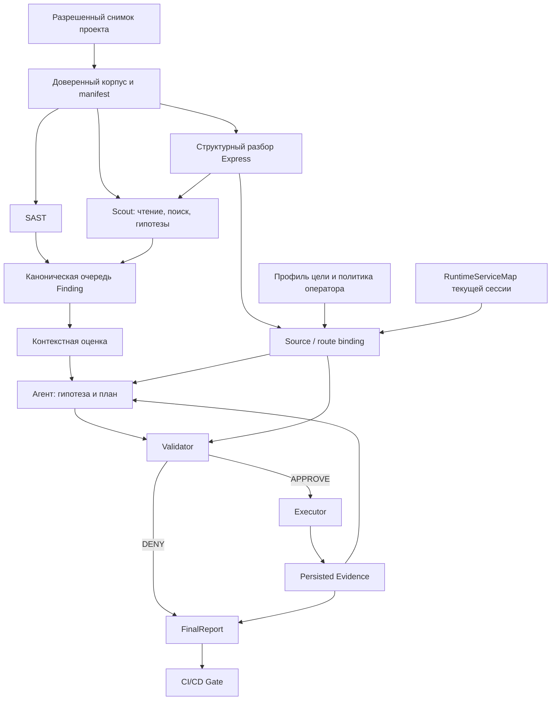

# План этапа: надежный поиск, карта Express и проверка находок

Дата: 2026-10-08.

Проект: CFT Security Agent.

Корень рабочей копии: /Users/stavrmoris/Desktop/cft-security-agent. Пути к компонентам ниже указаны относительно этого корня, если отдельно не написано другое.

Проверенная рабочая ветка на момент составления: codex/agent-verification-v3.

Статус документа: план разработки. Описанные ниже тесты, эксперименты, новые контракты и приемочные прогоны предстоит выполнить. Чтение кода при подготовке этого документа не является их выполнением.

Этот документ детализирует ближайшую часть [общего плана](implementation-plan-2026-10-08.md): P0, оставшуюся работу P1, P2, необходимый минимум P3/P4 и отображение результатов. Автоматическое исправление кода имеет следующий отдельный этап, описанный в P6 общего плана.

## 1. Конкретный результат этапа

Агент должен пройти воспроизводимый путь:

1. Получить точный снимок разрешенного локального проекта.
2. Собрать ограниченный корпус исходников и объяснить, какие файлы исключены.
3. Выполнить SAST и самостоятельное исследование исходников через Scout.
4. Сохранить кандидатов с точными прочитанными строками и происхождением.
5. Для поддерживаемых Express-конструкций восстановить маршрут, обработчик и порядок middleware.
6. Объединить сигналы в каноническую очередь Finding, сохранив источники.
7. Связать подходящую находку с разрешенной стратегией проверки.
8. Провести каждое активное действие через Validator и Executor.
9. Сохранить структурированные доказательства и объяснить терминальный вердикт.
10. Показать в интерфейсе исходный код, маршрут, действие, результат и ограничения.
11. Повторить реальный CI-проход в новой лабораторной сессии и сопоставить результаты.

Практическая цель демонстрации: открыть настоящую находку Juice Shop и показать цепочку «как агент ее заметил, где она находится, какой маршрут связан с обработчиком, что именно разрешил Validator, какую проверку выполнил Executor и почему получился вердикт».

Количество кандидатов само по себе не является условием успеха. Прирост качества подтверждается разбором конкретных находок, покрытием и корректностью контрольных случаев.

## 2. Границы этапа

### Обязательная часть

- Регрессионные проверки текущего Scout и интеграции в конвейер.
- Учет корпуса, покрытия, ограничений и причины остановки.
- Отдельный чистый запуск Scout на зафиксированном Juice Shop.
- Ограниченный разбор Express/JavaScript/TypeScript через AST.
- Межфайловые импорты обработчиков и подключения Router для объявленной поддержки.
- Единое семейство правила для объединения и выбора проверок.
- Привязка source → route → service → разрешенная стратегия.
- Корректные существующие проверки SQL и файловых поверхностей.
- Доказательства с точным scope и связью с действием/сессией.
- Отображение маршрута, разрешения, действий и причин непроверенности.
- Два реально выполненных сквозных CI-прогона после фиксации реализации.

### Дополнительная часть при готовой инфраструктуре

Read-only проверка ownership с двумя синтетическими учетными записями. Ее подключение требует зарегистрированного setup fixture и проверяемого ожидания доступа. Если эти компоненты отсутствуют, задача получает отдельный срок и не задерживает приемку SQL/файловых проверок.

### Следующие этапы

Автоматическое применение исправлений, проверка патча в Docker, runtime XSS через браузер, полная разметка Juice Shop, общий DAST baseline и полный расчет метрик Беспалова остаются следующими задачами. Этот этап готовит для них пригодные данные и стабильную проверку.

## 3. Что подтверждено чтением текущего кода

| Компонент | Что уже есть | Что требует работы |
|---|---|---|
| agent/repository_scout.py | Окна исходников, поиск буквальной строки, запросы чтения, пронумерованные строки, проверка provenance, бюджет кандидатов | Память исследования, полный размер запроса, единый deadline, завершение при ошибках/отмене, справедливость между компонентами |
| tools/repository_source.py | Ограниченный корпус, фильтрация путей, symlink-проверки, маскирование части секретов | Версия политики, manifest снимка, отдельные причины исключения, раздельный структурный и модельный текст |
| schemas/scout.py | До 32 кандидатов за ответ; до 256 в накопленном batch | Контракт ограниченной памяти и ссылки на конкретные элементы карты |
| discovery/express_routes.py | Лексический разбор прямых регистраций, локальный порядок use, импортированные файлы | AST, область видимости переменных, символ обработчика, Router mounts, неизвестные связи |
| schemas/source_map.py | Карта маршрутов и middleware | Source anchors, определения функций, локальный и полный путь, цепочка mount, версия адаптера и полнота |
| candidate-route-links.json | Сопоставление кандидата с регистрацией или импортированным файлом | Файл без конкретного символа не дает однозначной привязки к обработчику |
| discovery/scout.py | Семейства правил и объединение по диапазонам | Общий normalizer, сохранение обоих источников, коллизии ID, журнал объединения |
| agent/verification.py | Registered source artifacts и разрешенные кандидаты действий | Подбор зависит от точного file:line и подстроки scanner rule |
| validator/validator.py | Проверка artifacts, endpoint, mode, разрешений | Новая source-derived привязка с сохранением границы разрешений |
| executor/worker.py | Ограниченные SQL и directory observations | Проверка достаточности контроля, защищенных и нерелевантных случаев |
| schemas/security_tools.py | Typed результат с source/runtime scope | Явные предусловия, безопасное опровержение, связь с binding/snapshot/session |
| reporting/frontend | История действий, команды, Evidence, отчет | Маршрут и middleware, причины неприменимости, точное отличие argv от описания capability |
| targets/ | Постоянные профили SberLab и autodealer | Постоянного Juice Shop профиля в этом каталоге сейчас нет |

Последний выполненный контроль изменений: Ruff по выбранным Python-файлам и git diff --check. Полный backend suite, frontend tests/build и чистый Juice Shop запуск после этих изменений не выполнялись.

В рабочей копии уже есть большое количество изменений, включая предыдущую работу и посторонние файлы. При реализации сначала фиксируется перечень относящихся к этапу файлов.

### 3.1. Технические разрывы, которые нельзя пропустить

1. Текущий lexical parser ищет Express-инициализаторы по токенам. Без правильной области видимости он может ошибочно связать переменную и вызов из другого выражения.
2. Карта строится из RepositorySource.lines после маскирования и ограничения длины строки. Такой текст может изменить синтаксическую структуру. AST должен получать исходные ограниченные байты, а модель должна получать очищенные окна.
3. Импорт обработчика сейчас разрешается до файла. В одном файле может быть несколько функций с разными маршрутами и защитой.
4. Router-local path и полный application path еще не разделены. Локальный путь Router нельзя автоматически использовать как адрес запроса.
5. Карта передается Scout и сохраняется в артефакты, но не становится полноценной привязкой Finding/AgentState/Validator.
6. Общий normalizer находится в merge-коде, а выбор runtime verifier проверяет scanner-specific rule. Это разрывает путь Scout-кандидата к существующим SQL/файловым возможностям.
7. Точные строки в metadata профиля остаются обязательными для текущих runtime checks. Добавление комментария перед обработчиком может отключить проверку.
8. Наличие положительного и отрицательного HTTP-наблюдения еще не гарантирует, что различие вызвано именно SQL-инъекцией. Нужны защищенный и нерелевантный контрольные серверы.
9. Файловое расширение само по себе не устанавливает чувствительность опубликованного файла. Требуется независимое ожидание от операторского профиля/fixture.
10. Часть контекста карты и middleware обрезается по лимитам. Обрезание должно явно отражаться, чтобы из неполной цепочки не выводилось отсутствие защиты.

## 4. Архитектура этого этапа



Карта исходников описывает связи. Право активного доступа задается операторским профилем и проверяется Validator. Адрес контейнера поступает только из RuntimeServiceMap той же сессии.

Topology LangGraph и смысл confirmed/rejected/inconclusive/policy_blocked сохраняются. Новые данные передаются через общие сериализуемые схемы.

## 5. Организация работы и контрольные точки

| Пакет | Результат | Зависимость | Предварительная трудоемкость |
|---|---|---|---|
| E0 | Проверенная исходная точка и зафиксированный target | Текущая рабочая копия | 2–4 часа |
| E1 | Надежный Scout и полная диагностика ограничений | E0 | 4–8 часов |
| E2 | Диагностический source-only запуск A и ревью кандидатов | E0/E1 | 2–4 часа плюс время LLM |
| E3 | AST-карта Express, handlers, middleware и Router mounts | E0; может идти вместе с E1 | 10–16 часов |
| E4 | Каноническая provenance и разрешенные source/runtime bindings | Контракты E3 | 5–8 часов |
| E5 | Достаточные SQL/файловые доказательства и защищенные controls | E4; fixture-работа раньше | 8–14 часов |
| E6 | Отчет/API/UI с понятными маршрутами и действиями | Контракты E4/E5 | 4–6 часов |
| E7 | Запуск B, два CI-прохода, итоговая приемка | E1–E6 | 4–8 часов плюс runtime |

Это оценка инженерного времени, а не обещанный срок. Суммарно 39–68 часов при перечисленном scope. Один исполнитель: ориентировочно 5–9 рабочих дней. Часть E1/E3/E5/E6 можно вести параллельно при согласованных схемах.

Прежде чем увеличивать бюджет поиска, измерить стоимость и длительность запуска A. Продолжительность CI зависит от числа findings, LLM-ответов, runtime setup и лимита на каждый finding.

## 6. E0. Зафиксировать и проверить исходную точку

### E0.1. Рабочая копия

1. Записать HEAD, ветку, status, список релевантных измененных и новых файлов.
2. Отделить исходники от pycache, окружений, временных отчетов и посторонних каталогов.
3. Проверить локальный main и известных родителей текущей ветки. Интеграцию чужих commits планировать отдельно.
4. Сохранить manifest релевантного agent-кода, чтобы результаты можно было связать с dirty snapshot.
5. Продолжать в существующей ветке до стабилизации. Новый checkout полезен только при необходимости изоляции и с явным переносом нужных изменений.
6. Не выполнять общий git add, reset или очистку пользовательских файлов.

Выход: baseline-state.json с commit, кодовым digest, списком проверяемых компонентов и результатами проверок.

### E0.2. Проверки без целевого runtime

Последовательно:

- Существующие Scout/model-scout tests.
- Контракты, bounded verification, Validator/Executor, Evidence.
- Детерминированный LangGraph проход.
- Frontend format/timeline/interaction tests.
- Полный backend suite и Ruff после устранения релевантных failures.
- Frontend build.

До исправления теста определить: регрессия этапа, ошибка предыдущей работы или ограничение платформы. Skips записывать с точной причиной. Тест с реальным Docker отдельно от unit suite.

### E0.3. Точный снимок Juice Shop

1. Найти существующий checkout и проверить его текущий commit/dirty status.
2. Для сопоставления можно использовать commit 5658473cf8814459bf89000ce373b20ed0b4eb37, указанный в предыдущем отчете, если такой checkout доступен.
3. При выборе другой версии зафиксировать изменение до первого нового запуска.
4. Записать версию Express из target package/lockfile, Node/runtime image и команды операторской сборки.
5. Проверить, что target находится отдельно от агента.
6. Создать/восстановить операторский Juice Shop TargetProfile под trusted targets root.
7. В профиль внести services, compose/runtime mapping, разрешенные операции и endpoints. Ответы бенчмарка и метки «этот участок уязвим» в модельный контекст не переносить.
8. Для dirty target записывать digest точных байтов, а не ограничиваться Git HEAD.

Выход: target-snapshot.json и профиль цели. Во всех следующих запусках используется тот же snapshot либо явно записывается причина изменения.

### E0.4. LLM preflight

- Зафиксировать настроенные provider/model routes и timeout/fallback параметры без ключей.
- Проверить один минимальный структурированный ответ и затем малый ответ формы ScoutTurn.
- Проверить обработку неподдерживаемого параметра/невалидного ответа.
- Записать фактически выбранный маршрут и число transport attempts.
- Источник конфигурации записывать как env/local-config/default; секретные значения не выводить.

При отказе LLM diagnostic сохраняется. Source/SAST работа и уже принятые кандидаты остаются доступны.

### Gate G0

Есть воспроизводимая исходная точка; relevant tests проходят; blockers перечислены; target и модельный маршрут определены. Утверждения о приросте качества до нового эксперимента не делаются.

## 7. E1. Надежность Scout и учет исследования

### E1.1. Версионированный корпус

Расширить RepositorySource:

- policy_version и причины допуска/исключения;
- число обнаруженных, eligible, indexed, excluded файлов;
- размеры исходного корпуса и модельного представления;
- raw digest каждого indexed файла и общий snapshot digest;
- исключенные пути с безопасной причиной;
- сведения о long-line truncation, ошибках декодирования и маскировании;
- известные каталоги эталона/solutions/test answers исключены из всех read/search/related/memory каналов.

Не исключать runtime-модуль только из-за слова challenge в имени. Политика задает исключение данных ответов, сохраняя реальный application code.

Одинаковая политика используется при source-map inventory и Scout. Для SAST сохранить raw результаты, но сопоставимые показатели считать отдельно по согласованному application scope.

### E1.2. Два представления одного файла

Структурный анализ получает ограниченные исходные байты. Модель получает очищенные пронумерованные окна.

Связь между ними:

- одинаковый relative path и raw digest;
- сохраненная нумерация физических строк;
- AST anchors по byte offsets и строкам исходного файла;
- явные пометки о скрытых/обрезанных частях модельного окна;
- структурный результат экспортирует только безопасные имена, пути и anchors;
- найденные строковые credentials не передаются в карту, LLM или UI.

Содержимое raw-корпуса не записывать автоматически в model payload. Чтение raw для parser не считается прочитанным моделью диапазоном.

### E1.3. Бюджеты

Сохранить существующие лимиты и добавить контроль:

| Бюджет | Что измеряется |
|---|---|
| Corpus | Файлы, bytes/file, total bytes |
| Новое чтение | Реально отправленные новые окна |
| Search | Подготовленные и отправленные совпадения отдельно |
| Повторный контекст | Символы повторно отправленных окон |
| Память | Число items и сериализованный размер |
| Карта | Routes/symbols/middleware и размер релевантного slice |
| Полный запрос | Сериализованный payload плюс служебная часть запроса |
| Ответ | Установленный output-token limit и фактический usage при доступности |
| Transport | Attempts, fallbacks и wall deadline |
| Candidates | Принятые, дубликаты, отвергнутые и dropped по лимиту |

Названия новых настроек определить при реализации; предварительно max_request_chars, max_memory_chars, max_transport_attempts. Значения вводить в Settings с диапазонами и документировать.

Политика ужатия запроса: убрать нерелевантную карту, старые повторные окна и второстепенные items памяти; сохранить source anchors текущего чтения. Если обязательные данные не помещаются, уменьшить очередную batch до отправки и явно записать ограничение.

Полный payload считать по фактически сериализованному запросу. Character estimate не подписывать как exact token usage.

### E1.4. Очереди

- Сохранить round-robin между файлами.
- Добавить порядок между компонентами, чтобы большой frontend не вытеснял backend.
- Приоритет модели ограничить долей batch или числом consecutive requested reads.
- Перекрывающиеся диапазоны объединять для coverage.
- Повторное чтение учитывать отдельно; одинаковый read request не должен зациклить run.
- Запрос к непрочитанному окну ставить в очередь с ожидаемым размером.
- Если лимит не позволяет отправить окно, сохранить его как pending.
- Не терять окно при снятии с очереди перед проверкой бюджета.
- Формальное completed возможно только при исчерпании допустимых очередей без скрытых pending items.

### E1.5. Сериализуемая память

Минимальный контракт item:

- id;
- kind: observation, hypothesis, open_question, control_to_review;
- короткий текст;
- source anchors;
- related route/symbol IDs;
- status и created/updated turn.

Проверяемые условия:

1. Observation ссылается на фактически отправленный и успешно обработанный диапазон.
2. Model summary сохраняет авторство модели; оно не становится Evidence.
3. Open question может ссылаться на известный непрочитанный symbol, но явно остается нерешенным.
4. Controls требуют чтения определения и места вызова для содержательного вывода.
5. Обновление item не расширяет файловый/сетевой scope.
6. Items без валидных anchors отклоняются или сохраняются как вопрос, а не факт.
7. Память ограничивается по числу и размеру; removed/compacted items учитываются в summary.

Не добавлять vector database. Хватает небольшого объекта в существующем цикле Scout.

### E1.6. Завершение, ошибки и audit

Единый набор причин остановки:

- completed;
- no_application_source;
- source_budget;
- turn_budget;
- candidate_budget;
- wall_clock_budget;
- model_unavailable;
- cancelled.

Отдельно сохранить transport/model response error category. Невалидная схема, timeout и отсутствие credentials не должны превращаться в одинаковую неинформативную строку.

Summary формируется при раннем сбое и отмене. Cancelled сохраняет частичную диагностику и затем продолжает штатный cancellation flow всего CI; отмена не гасится локальным return.

Deadline передается transport: timeout следующей попытки ограничен остатком бюджета. Новый fallback не начинается, если ему не осталось времени.

### Gate G1

Нет потерянного окна, ложного completed, неучтенного payload или принятого кандидата за пределами прочитанных anchors. Ошибка/отмена сохраняет полезный partial summary.

## 8. E2. Source-only запуск A и анализ качества

### E2.1. Условия запуска

- Тот же зафиксированный Juice Shop snapshot.
- Рабочий LLM route и зарегистрированная конфигурация.
- Исходные лимиты по умолчанию: 8 turns, 32 candidates, 160000 source chars, 240 секунд.
- Если эти лимиты меняются, причина и новые значения записываются до запуска.
- Новый run ID и пустой output directory.
- Target application при source-only запуске не исполняется.

Назначение A: понять реальные ограничения текущего поиска и получить сопоставимую исходную точку для B.

### E2.2. Сохраняемые результаты

- Target и agent snapshot manifests.
- Конфигурация, модельный маршрут и transport attempts.
- Eligible/indexed/excluded файлы.
- Submitted/reviewed ranges и уникальные строки.
- Prepared/submitted search results.
- Candidates и причины их отклонения.
- Карта и candidate-route links.
- Причина остановки, pending queues и длительность.
- Очищенные input/output payload либо их безопасные audit-представления.

### E2.3. Ревью каждого кандидата

Для каждой записи подготовить review-candidates-A.json и читаемую таблицу:

- rule family, anchor и краткое утверждение;
- действительно ли участок был прочитан;
- source → sink или чувствительная операция;
- найденные guards/sanitizers/parameterization;
- что известно о маршруте;
- каких предусловий не хватает;
- подходит ли зарегистрированная проверка;
- причина duplicate/redundant/no_supported_check;
- reviewer outcome: plausible, contradicted_by_source, duplicate, needs_context.

Reviewer outcome отделяется от итогового агентного verdict.

### E2.4. Как искать пропуски

Разбирать причины, а не только count:

1. Файл исключен корпусом.
2. Файл проиндексирован, но окно не отправлено.
3. Окно отправлено, но запрос завершился ошибкой.
4. Код просмотрен, модель не сформировала кандидат.
5. Кандидат возвращен, но anchor/provenance невалиден.
6. Кандидат потерян при merge.
7. Кандидат принят, но route/symbol unresolved.
8. Route известен, но политика/fixture/verifier не поддерживает проверку.
9. Проверка выполнена, но Evidence недостаточно.

Ожидаемые случаи для development review фиксируются до B. Эталон хранится отдельно от Scout-корпуса и исключен из provider payload. Не расширять denominator постфактум только по удачным находкам.

### Gate G2

Все принятые кандидаты разобраны. Есть список конкретных причин пропусков и проверяемых доработок. Предварительное ревью не выдается за полноценный benchmark.

## 9. E3. AST-карта Express

### E3.1. Выбор parser

Предпочтительная рабочая гипотеза: Tree-sitter через Python bindings с JS и TS/TSX grammar. Python-интерфейс и отдельные TS/TSX грамматики представлены в первичных источниках: [py-tree-sitter](https://github.com/tree-sitter/py-tree-sitter), [tree-sitter-typescript](https://github.com/tree-sitter/tree-sitter-typescript).

Перед окончательным выбором провести ограниченный эксперимент:

1. Установить совместимые закрепленные версии в агентное окружение.
2. Разобрать набор реальных JS/TS/TSX файлов выбранного snapshot.
3. Проверить byte offsets, Cyrillic, BOM, comments, multiline и JSX.
4. Проверить AST nodes для imports, factory handlers, app/router calls.
5. Измерить время и размер дерева на наибольшем допустимом файле.
6. Проверить malformed syntax и ERROR nodes.
7. Зафиксировать решение и версии в коротком ADR.

Если выбран другой parser, он должен читать текст без запуска target imports, package scripts или конфигурационного кода. Существующий tokenizer можно оставить diagnostic fallback с явным низким уровнем полноты; такой результат не дает runtime binding автоматически.

### E3.2. Общие схемы

Расширить schemas/source_map.py. Конкретные названия согласовать при реализации; необходимые сущности:

| Сущность | Основные поля |
|---|---|
| SourceAnchor | Relative path, raw digest, start/end line, byte range |
| SourceSymbol | Symbol ID, имя, тип, export/import, definition anchor, resolution state |
| RouterInstance | Instance ID, definition, scope, Express origin, known options |
| RouterMount | Parent/child instance, static prefix/template, ordered middleware, source anchor |
| RouteDefinition | Method, local path, handler symbol refs, ordered arguments, registration anchor |
| RouteContext | Full template, mount chain, effective middleware, resolution state, reasons |
| CandidateRouteLink | Finding/candidate ref, exact relation, ambiguity, unknown preconditions |

Не хранить AST tree, parser handles или SDK-объекты в AgentState. Только сериализуемые результаты.

Карта содержит schema_version, adapter_version, snapshot_digest, corpus_policy_version, parser_versions, unresolved records, omitted counts и truncation reasons.

Совместимость v1: old artifacts остаются читаемыми либо используется явный loader/migration. UI получает дополнительные поля через defaults. Shared model consumers перечисляются до изменения.

### E3.3. Разрешение символов

Начальный поддерживаемый набор:

- ESM default/named imports, aliases, static namespace member.
- Явные export function/const/default и простые re-exports.
- CommonJS require/module.exports для однозначных форм.
- Локальные функции, const arrow handlers и inline callbacks.
- Handler factory, возвращающая callback, при однозначной статической структуре.
- Простые неизменяемые aliases Express app/Router.
- Относительные imports внутри approved corpus.

Неоднозначность сохраняется при reassignment, shadowing, dynamic require/import, computed member, условном export и неизвестном wrapper.

Ограничить глубину re-export/helper exploration, число symbols и ребер. Циклы импортов не запускают рекурсивный обход без лимита.

Path aliases поддерживать только при статически прочитанной известной конфигурации. Если соответствие не установлено, вернуть unresolved_import.

### E3.4. Express instances и route calls

1. Установить, что вызываемая функция действительно импортирована из Express.
2. Связать app/Router с конкретной definition и lexical scope.
3. Разобрать прямые method calls и аргументы в исходном порядке.
4. Включить app.route(path).get/post цепочки, если они встречаются в выбранном target.
5. Для ALL сохранить метод ALL; конкретный HTTP method для проверки берется из разрешенной стратегии.
6. Сохранить error handlers, control-flow boundaries и неизвестные wrappers.
7. Не считать похожий объект с методом get экземпляром Express по одному имени переменной.

Версию Express учитывать при интерпретации path syntax и options. Route patterns и Router mounting описаны в [официальном руководстве Express](https://expressjs.com/en/guide/routing/).

### E3.5. Пути и подключения Router

Разделить:

- route-local path;
- mount prefix/template;
- full application route template;
- concrete endpoint текущей разрешенной проверки.

Пример структурного результата:

```text
server: app.use("/api", accountRouter)
router: accountRouter.use("/orders", ordersRouter)
ordersRouter.get("/:id", ownershipGuard, readOrder)

template: /api/orders/:id
concrete endpoint: только из разрешенного fixture/profile
```

Поддержать вложенные mounts в установленной глубине, один Router на нескольких prefixes и ordered arrays при статической структуре.

Router может определять свои routes до или после app.use в исходниках. Его membership устанавливается по instance identity; это отдельный вопрос от порядка app middleware.

Для function-local conditional mounts, regex paths, вычисляемых префиксов и неразрешенных imports сохранять unresolved. Не заменять template фиктивным номером объекта.

### E3.6. Порядок middleware

Цепочка строится из:

1. Подходящих parent app layers до конкретного mount.
2. Middleware непосредственно в mount.
3. Parent Router layers.
4. Local Router layers до route.
5. Route arguments в их порядке.

Запись после terminal handler не автоматически защищает предшествующее действие. Смысл next, next(route), раннего ответа и exception path анализировать ограниченно; неизвестные переходы остаются в карте.

Различать scopes: application, mount, router, route, handler.

Обрезанная цепочка получает middleware_context_incomplete. Отсутствие распознанного guard при таком состоянии не становится доказанным отсутствием защиты. Порядок и типы middleware опираются на [официальное описание Express middleware](https://expressjs.com/en/guide/using-middleware/).

### E3.7. Защитные проверки и операции

На этом этапе карта фиксирует:

- observed guard call и definition anchor;
- место вызова до/внутри/после чувствительной операции;
- request inputs;
- query/file/access-control operation;
- наличие явно распознанной параметризации/escape call;
- нерешенные helper dependencies.

Название authenticate или sanitize не является semantic proof. Статически распознанная структура защиты также не гарантирует ее правильность во всех runtime состояниях.

При поддержанном локальном анализе можно заявить source condition. Общие выводы о runtime остаются за зарегистрированным verifier.

### E3.8. Идентификаторы

- Occurrence ID связан с конкретным snapshot и source anchor.
- Semantic fingerprint использует family, путь, разрешенный handler/sink и нормализованную структуру.
- Номер строки хранится как anchor, но не является единственным межверсионным ключом.
- Два одинаковых вызова в одном handler сохраняются как отдельные occurrences.
- При недостаточной структуре fingerprint помечается слабым; неоднозначные случаи не объединяются автоматически.

Для сдвига строк проверяется стабильность relation/fingerprint. Полномочия runtime binding все равно проверяются заново для нового snapshot.

### Gate G3

Объявленные конструкции проходят fixture matrix. Для реальных выбранных handlers Juice Shop есть точная цепочка route → middleware → handler → relevant operation. Неподдержанные части обозначены и не порождают разрешение на активный запрос.

## 10. E4. Finding provenance и разрешенная привязка

### E4.1. Единое семейство

Выделить один deterministic normalizer для SAST, Scout, merge и verifier selection.

Начальные families: sql-injection, file-exposure, path-traversal, access-control, authentication, xss, open-redirect; неизвестные scanner rules сохраняют оригинальное значение и не получают расширенный verifier по случайному совпадению строки.

Original scanner rule, source severity и source IDs сохраняются. Family не меняет CVSS и не означает подтверждение.

### E4.2. Объединение

- Сохранять origins SAST/Scout и rationale обоих источников.
- Сопоставлять по operation/handler/route и narrow anchor, когда они разрешены.
- Простое широкое пересечение строк не является достаточным основанием merge.
- Не терять разные operations на одной строке.
- Проверять уникальность внутренних IDs независимо от scanner IDs.
- Сохранять possible_duplicate при неоднозначности.
- Формировать merge-log.json с причиной каждого объединения.
- Выполнять scoring над итоговой очередью.

Raw signals, source candidates, merged findings и matched reference cases показываются отдельными числами.

### E4.3. Минимальный контракт binding

Расширить существующие schemas/target.py и schemas/source_map.py. Контракт привязки должен содержать:

- binding ID и version;
- finding/operation ref;
- target ID, snapshot digest;
- source artifact ID и operation anchor;
- route ID/template, handler ID;
- service ID;
- конкретный разрешенный endpoint и HTTP method;
- capability, check/mode и strategy version;
- policy selector/profile reference;
- fixture ID/role при необходимости;
- readiness/session binding для исполнения;
- unresolved/denied причины.

Не дублировать Finding/ActionProposal/Evidence локальными моделями. В AgentState передать registry или ref, состоящий из сериализуемых данных.

### E4.4. Алгоритм разрешения

1. Найти canonical operation для Finding.
2. Разрешить handler и маршрут по карте того же source snapshot.
3. Для нескольких подходящих routes сохранить множество и применить операторский selector.
4. Проверить service/component mapping; межсервисное соответствие не угадывать.
5. Проверить capability prerequisites для операции.
6. Пересечь source-derived route со scope разрешений профиля.
7. Получить конкретный endpoint для статического path либо fixture parameters.
8. Привязать service к ready RuntimeServiceMap текущей сессии.
9. Сформировать один или несколько разрешенных strategy candidates.
10. Если этап не выполнен, сохранить конкретную причину и доступную source strategy.

Операторский selector ограничивает service, family/capability, method, route/template и fixture. Правило «разрешить все найденные маршруты» по умолчанию не вводится.

Legacy metadata по file:line остается совместимым override. Оно проходит те же проверки scope и snapshot; legacy binding не дает bypass новым ограничениям.

### E4.5. Validator

Проверить:

- target/environment;
- зарегистрированную capability и параметры;
- binding ID/version и snapshot;
- соответствие source artifact/operation/route;
- service, endpoint, method и test role;
- policy selector и request quota;
- принадлежность runtime session;
- полный digest ActionProposal.

Поле endpoint заполняется приложением из разрешенной привязки. Provider response с другим path/host/mode не может изменить привязку.

Method должен быть частью typed contract или фиксированной семантики capability. Поле в payload, которое worker игнорирует, не дает гарантии ограничения метода.

### E4.6. Executor и повторная проверка

Executor использует одобренный ActionProposal и проверяет его digest. Source artifact и binding разрешаются через доверенный registry. Worker повторно проверяет containment и формат параметров.

URL строится из internal runtime address и одобренного endpoint. External redirects не следуются. Generic sandbox_command сохраняет networkless исполнение и не наследует target network.

Runtime registry не редактируется LLM. Смена target/session/snapshot требует новых bindings и approval.

### Gate G4

Scout и SAST находки одного поддержанного класса могут выбрать одинаковый verifier. Сдвиг строк не ломает semantic relation, но мутированный artifact/path/endpoint/session отклоняется.

## 11. E5. Достаточные доказательства SQL и файловых поверхностей

### E5.1. Source inspection

Убедиться, что check относится к конкретной operation:

- direct input interpolation устанавливается по поддержанной структуре;
- наличие слова query или объекта replacements само по себе не определяет безопасность;
- helpers/sanitizers разрешаются либо получают unknown;
- source condition содержит source scope;
- runtime_exploitability_verified остается false без runtime observations.

Один finding не получает runtime вывод только потому, что другой finding в том же файле был подтвержден.

### E5.2. SQL differential

Прежде чем расширять проверку, проверить существующий verifier на независимых локальных cases:

1. Уязвимый поддержанный handler.
2. Корректно параметризованный handler.
3. Нерелевантный endpoint, возвращающий разные counts на разные строки обычным application behavior.
4. Endpoint с HTTP 500 без SQL-дефекта.
5. Endpoint с нестабильным/cache/random результатом.
6. Endpoint с неожиданной JSON-схемой.
7. Недоступный runtime.

Достаточная стратегия включает функциональный baseline, согласованную пару контрольных наблюдений, повторяемость и проверку expected response shape. Различие должно соответствовать проверяемой гипотезе и не объясняться просто разными поисковыми строками.

Предикат confirmed версионируется и тестируется на всех перечисленных cases. Сохранять statuses, counts/booleans, timings и redaction flags; строки пользователей, пароли и токены в Evidence не нужны.

Для authentication mode отдельно задаются разрешенные synthetic identity, fixture prerequisites и cleanup. Search mode и authentication mode имеют разные достаточные условия.

Неуспех одной проверки дает inconclusive, если нет достаточного опровержения исходной гипотезы.

### E5.3. Файловая поверхность

Сначала определить проверяемое утверждение:

- опубликован directory index;
- раскрыта известная чувствительная поверхность;
- доступна synthetic marker-поверхность, которую политика считала закрытой.

Эти утверждения имеют разный scope. Не превращать любое backup-like имя в доказательство раскрытия чувствительных данных.

Runtime observation:

- разрешенный listing endpoint;
- ограниченный размер ответа;
- фиксированная parsing strategy;
- известное операторское ожидание чувствительности;
- отсутствие загрузки содержимого чувствительных файлов;
- позитивный контроль намеренно публичного ресурса;
- внешние ссылки и redirects исключены;
- filename values при необходимости маскируются.

Protected fixture должен сохранять публичные assets и закрывать запрещенную поверхность. Ошибка 404 на всем приложении не доказывает корректную защиту.

Traversal остается отдельной strategy с lab-owned marker и отдельным разрешением; ее нельзя автоматически подставлять вместо directory check.

### E5.4. Evidence contract

Расширить BoundedVerificationResult или согласованный существующий тип:

- schema/strategy version;
- binding/source/route refs;
- observation scope;
- satisfied/unknown prerequisites;
- structured control/probe observations;
- reason code;
- verdict;
- redaction/truncation flags.

Привязку к approved action и session формирует trusted execution envelope. Worker не может самостоятельно выбрать чужой action ID.

Interpreter проверяет tool, artifact, operation, binding, session, scope и output schema. Stdout generic command с похожим JSON не превращается в trusted verdict.

### E5.5. Терминальная семантика

| Исход | Условие |
|---|---|
| confirmed | Зарегистрированная проверка дала достаточные supporting observations в указанном scope |
| rejected | Достаточное опровержение именно исходного утверждения, включая известные предусловия |
| inconclusive | Не хватает context, fixture, runtime, контрольного результата или времени |
| policy_blocked | Нужное предложенное действие отклонено Validator |
| Technical error | Ошибка исполнения/хранения/transport с отдельным ErrorDetail |

Source hardening condition, static data flow и runtime violation показываются раздельно. Severity и Gate не повышаются по имени capability.

### Gate G5

Vulnerable/protected/unrelated cases дают ожидаемые исходы. Поддельный JSON, ошибочный endpoint и произвольный HTTP 500 не создают confirmed.

## 12. E6. Интеграция в граф, API и интерфейс

### E6.1. Reasoning

Модель получает:

- finding и сохраненные origins;
- краткую route/handler/middleware цепочку;
- unknown preconditions;
- разрешенные strategy candidates;
- накопленные Evidence;
- оставшийся budget.

Модель выбирает strategy/purpose из допустимого контекста. Target/service/endpoint/artifact/action IDs выставляет приложение.

При reevaluate учитываются новый Evidence и причины неполноты. Один и тот же проверочный action не повторяется бесконечно. Exhausted strategies дают объяснимый terminal result.

### E6.2. Причины неприменимости

Согласованный список machine-readable причин:

- unsupported_family;
- source_anchor_unresolved;
- handler_unresolved;
- route_unresolved;
- ambiguous_route;
- middleware_context_incomplete;
- source_snapshot_mismatch;
- service_unresolved;
- runtime_unavailable;
- fixture_missing;
- strategy_not_applicable;
- endpoint_not_allowed;
- policy_blocked;
- budget_exhausted.

Причины могут сочетаться. Unsupported strategy сама по себе не является policy denial: action еще не предложен.

### E6.3. API/report

Изменения общих схем согласовать с builder, storage, API serialization и TypeScript types.

API передает artifact IDs и безопасные relative source anchors. Absolute host paths, credentials и live SDK objects отсутствуют.

В отчете доступны origins, family, source scope, route template, concrete approved operation, binding reason и ссылки на Evidence.

### E6.4. Что видит пользователь

Карточка finding:

1. Название и источники SAST/Scout.
2. Файл, handler и точные строки.
3. Маршрут и метод либо понятная причина unknown.
4. Свернутая ordered middleware цепочка.
5. Выбранная проверка и решение Validator.
6. Выполненное действие и результат.
7. Доказательства и границы вывода.

Карточка действия:

- Для sandbox_command: реально выполненный argv и cwd внутри контейнера.
- Для registered worker capability: фактическая capability, безопасные параметры и worker invocation/operation description.
- Для HTTP check: method, internal service и approved path; секретные headers и значения закрытых данных скрыты.
- Статус и время берутся из execution/audit, а не из шаблонной фразы модели.
- Streaming показывается только при наличии настоящих progress events.

Логи host Docker orchestration при необходимости находятся в run diagnostics. Их не выдавать за команды, которые самостоятельно выбрал агент.

Проверить Markdown, narrow layouts, long source paths, горизонтальный overflow, пустые маршруты и порядок события относительно итогового отчета.

### Gate G6

По карточке можно понять, что произошло, даже без LLM-резюме. Неполная карта и недостаточная Evidence явно отображаются. В интерфейсе нет фиктивного выполнения или лишних секретов.

## 13. E7. Приемка на Juice Shop и повторяемость

### E7.1. Запуск B

Повторить source-only исследование после E1/E3 с тем же target и сопоставимой конфигурацией A.

Если budgets/model/corpus изменились, разделить сравнения:

- одинаковые условия A/B;
- расширенный budget как отдельный диагностический вариант.

Сравнить candidate fingerprints, reviewed coverage, rejected/dropped кандидатов, route/handler resolution, strategy availability, время и model failures.

Не объяснять весь прирост одной картой, если одновременно заменили модель и увеличили бюджет.

### E7.2. Два полных CI-прохода C1/C2

Оба запуска выполняются после фиксации final implementation snapshot:

- одинаковые target/agent/config/rules snapshots;
- новая sandbox session и fixtures;
- новые run IDs, отдельные output directories;
- свежие pipeline reports и Evidence;
- фактические model routes/attempts сохранены;
- одинаковые лимиты;
- startup/readiness/cleanup diagnostics.

Старые отчеты можно использовать как историческую справку, но не как дополнительный новый прогон.

При различии модельного fallback или target snapshot отметить несопоставимость условия. При существенном расхождении провести третий настоящий диагностический запуск, если это требуется для выяснения причины.

### E7.3. Операционные показатели этапа

| Показатель | Единица и знаменатель |
|---|---|
| Corpus coverage | Indexed eligible files / все eligible files |
| Reviewed coverage | Уникальные reviewed строки / строки indexed corpus |
| Route resolution | Findings с точной source-route связью / findings в объявленном Express scope |
| Strategy availability | Findings с применимой разрешенной strategy / findings поддержанных families |
| Verification completion | Findings с завершенной проверкой / findings, для которых она была применима |
| Confirmations | Source/static/runtime counts отдельно |
| Candidate review quality | Результаты экспертного ревью всех кандидатов с обозначенным набором |
| Model reliability | Успешные calls / attempted calls; fallback и timeout отдельно |
| Execution reliability | Completed/failed/denied actions по зарегистрированным strategy |
| Repeatability | Сопоставление IDs, bindings, verdicts и Evidence C1/C2 |
| Duration/cost | Source, map, SAST, LLM, runtime, finding workflow отдельно |

Coverage reviewed означает обработку окна корректным модельным ответом, а не доказательство обнаружения всех дефектов в нем.

### E7.4. Подготовка к метрикам Беспалова

До численной оценки определить independent reference set, единицу случая и matching rule. Отдельно фиксировать positive cases, protected controls и неподдержанный scope.

Precision confirmed требует ревью всех confirmed. Recall считается по заранее заданному набору известных случаев в области эксперимента. Общий каталог заданий Juice Shop не автоматически равен числу source vulnerabilities.

Для false positive rate заранее выбрать формулу. Стандартный FPR использует FP/(FP+TN); доля ошибочных confirmed среди всех confirmed является другим показателем. Inconclusive отражается как abstention и не превращается автоматически в TN.

Два прогона позволяют показать наблюдаемую повторяемость на выбранном snapshot. Они не устанавливают устойчивость для всех версий и моделей.

Severity/Context Priority accuracy, полный DAST baseline и MTTR этот этап не закрывает. Для MTTR потребуется следующий цикл реальных исправлений с timestamps и заранее определенным смыслом измерения.

### Gate G7

Есть реальные C1/C2, результаты сопоставлены, все confirmed просмотрены, технические failures объяснены, артефакты сохранены. Прирост заявляется только в измеренном scope.

## 14. Минимальная обязательная тестовая матрица

Тесты ниже проверяют поведение и границы, а не повторяют строки реализации.

### Scout и корпус

| ID | Сценарий | Ожидаемое поведение |
|---|---|---|
| S01 | Кандидат на непрочитанной строке/через gap | Отклонен |
| S02 | Provenance содержит только найденный search файл | Полный read provenance не появляется автоматически |
| S03 | Модель stop при непустой seed queue | Исследование продолжено в пределах бюджета |
| S04 | Candidate cap и следующий уникальный кандидат | candidate_budget, точный dropped count |
| S05 | Дубликат при заполненном cap | Не расходует новое место |
| S06 | Последний turn исчерпал source | completed либо точный budget outcome при pending |
| S07 | Превышение source budget после search | Payload не превышен, окно остается pending |
| S08 | Невалидный model response | Partial candidates сохранены, reviewed не увеличен |
| S09 | Cancellation до/во время запроса | Partial audit и штатная отмена |
| S10 | Большой файл/компонент | Другие компоненты получают окна |
| S11 | Symlink/absolute/parent path | Нет чтения вне корпуса |
| S12 | Answer catalogs и secret literals | Отсутствуют во всех provider channels |
| S13 | Память без готового кандидата | Вопрос сохранен между turns |
| S14 | Memory anchor вне reviewed | Не принимается как observation |
| S15 | Общий deadline с fallback | Новая попытка не выходит за остаток бюджета |

### Карта Express

| ID | Сценарий | Ожидаемое поведение |
|---|---|---|
| R01 | Typed Express app и unrelated get object | Только реальный Express receiver |
| R02 | Shadowing/reassignment | Корректный scope либо unresolved |
| R03 | Named/default alias import | Точный symbol definition |
| R04 | Два handlers в одном module | Нет привязки по одному file match |
| R05 | Handler factory | Однозначный returned callback либо unknown |
| R06 | CommonJS export Router | Поддержанная mount chain |
| R07 | Два вложенных static mounts | Правильный full template |
| R08 | Один Router на двух prefixes | Две связи, сохраненная неоднозначность |
| R09 | Route объявлен раньше app.use(router) | Router membership не теряется |
| R10 | Middleware before/after mount | Разная effective chain |
| R11 | Guard после terminal handler | Не выдается за предшествующую защиту |
| R12 | Inline/array/imported middleware | Сохранен порядок |
| R13 | Dynamic path/conditional mount | Unresolved, нет concrete URL |
| R14 | Параметризованный path | Template отделен от fixture endpoint |
| R15 | app.route chain | Поддержан либо явно отмечен unsupported |
| R16 | Сдвиг строк, прежняя operation | Semantic relation стабильна |
| R17 | Два sinks на одной строке | Отдельные occurrences |
| R18 | AST error/long line truncation | Нет ложной полной карты |
| R19 | Cyrillic/BOM/CRLF | Верные anchors и offsets |
| R20 | Цикл imports/mounts, большие массивы | Bounded traversal, explicit omitted |

### Binding, политика и Evidence

| ID | Сценарий | Ожидаемое поведение |
|---|---|---|
| B01 | SAST и Scout одна family/operation | Одинаковая strategy, оба origins |
| B02 | Source route вне profile scope | Активное действие не разрешено |
| B03 | Подмена service/method/endpoint | Validator denial |
| B04 | Подмена artifact/snapshot/route ref | Denial до исполнения |
| B05 | Старый session registry | Нет исполнения в другой session |
| B06 | Legacy file:line | Совместимая строгая проверка |
| B07 | Mutation после approval | Digest mismatch, denial |
| B08 | Route unresolved/runtime unavailable | Точная причина inconclusive |
| V01 | SQL vulnerable/protected/unrelated | Корректные different outcomes |
| V02 | HTTP 500/random/schema mismatch | Нет confirmed |
| V03 | Public directory с backup-like именем | Нет автоматического sensitive verdict |
| V04 | Операторский synthetic sensitive marker | Проверка известного условия |
| V05 | Endpoint полностью сломан | Functional control не проходит |
| V06 | Generic stdout подделывает worker JSON | Нет trusted verdict |
| V07 | Worker result чужой binding/action | Interpreter отклоняет |
| V08 | Source-only proof | Runtime confirmation не появляется |
| V09 | Timeout/persistence failure | Structured error и сохраненные результаты других findings |

### Интерфейс

- Пустая/неоднозначная route context отображается понятно.
- Команды и операции соответствуют execution/audit.
- Long paths и длинные middleware names не ломают Runs.
- Markdown сообщения отображается корректно.
- Итоговый отчет следует после завершенных событий.
- Redacted values не раскрываются при раскрытии accordion.
- Old API artifacts отображаются с compatible defaults.

## 15. Изменения по файлам

| Область | Существующие файлы | Возможное новое содержимое |
|---|---|---|
| Corpus | tools/repository_source.py, discovery/service.py | Corpus manifest/policy helpers |
| Scout | agent/repository_scout.py, schemas/scout.py, app/config.py, app/scout.py | Bounded research memory и deadline/payload handling |
| AST | discovery/express_routes.py, schemas/source_map.py, pyproject.toml | Parser adapter, symbol resolution, ADR |
| Canonical queue | discovery/scout.py, schemas/finding.py | Shared family normalization и origins |
| Binding | agent/verification.py, schemas/target.py, schemas/state.py | Typed registry/refs и Juice Shop profile |
| Reasoning | agent/llm_model.py, agent/nodes.py | Application-owned strategy candidates |
| Validation | validator/validator.py, policies/default.yaml | Binding/method/snapshot/session checks |
| Execution | executor/executor.py, executor/worker.py | Fixed strategy inputs и typed observations |
| Evidence | schemas/security_tools.py, evidence/interpreter.py | Strategy versions и strict binding match |
| API/report/UI | schemas/report.py, reporting/builder.py, api serializers, frontend types/timeline/cards | Route context и applicability reason |
| Tests/docs | Existing suites и docs/source-scout.md | Behavioral fixtures, parser tests, stage report |

Новые modules добавлять только для отдельной ответственности. Общие contracts живут в schemas/. Не создавать вторую реализацию CI pipeline.

## 16. Команды при реализации

Ниже план команд, а не отчет об их выполнении.

### Backend regression

```bash
PYTHONDONTWRITEBYTECODE=1 .venv/bin/python -m pytest -q +  tests/test_repository_scout_source.py +  tests/test_model_scout.py +  tests/test_bounded_verification.py +  tests/test_validator.py +  tests/test_executor.py +  tests/test_evidence_guard.py

PYTHONDONTWRITEBYTECODE=1 .venv/bin/python -m pytest -q
.venv/bin/ruff check .
CFT_AGENT_MODE=stub PYTHONDONTWRITEBYTECODE=1 .venv/bin/python -m app.main
git diff --check
```

Новые map/binding tests добавляются к первой targeted команде после создания. Docker integration tests запускаются отдельно на доступном runtime.

### Frontend, cwd frontend/

```bash
npm test
npm run build
```

### Source-only diagnostic

Переменная STAGE_JUICE_REPO должна содержать проверенный абсолютный путь к зафиксированному checkout. Это рабочая переменная этапа, а не смена HOME/CODEX_HOME.

```bash
CFT_AGENT_MODE=llm PYTHONDONTWRITEBYTECODE=1 .venv/bin/python -m app.scout +  --target "$STAGE_JUICE_REPO" +  --output-dir artifacts/scout-routing-2026-10-08/source-A +  --max-turns 8 +  --max-candidates 32 +  --max-output-tokens 4096
```

Для B использовать новый каталог source-B, сохраняя объявленные сопоставимые условия. При повторном запуске не перезаписывать существующий run.

### Full CI

targets/juice-shop.yaml ниже является планируемым профилем, которого сейчас нет. STAGE_SAST_RULES обозначает заранее закрепленный локальный ruleset.

```bash
PYTHONDONTWRITEBYTECODE=1 .venv/bin/python -m app.ci_pipeline +  --target "$STAGE_JUICE_REPO" +  --profile targets/juice-shop.yaml +  --sast-config "$STAGE_SAST_RULES" +  --agent-mode llm +  --max-iterations 3 +  --full-reports +  --output-dir artifacts/scout-routing-2026-10-08/full-C1
```

C2 получает другой output directory и новую sandbox session. Exit 1 при confirmed/Gate FAIL означает завершенный security failure; exit 2 является техническим failure.

## 17. Артефакты приемки

```text
artifacts/scout-routing-2026-10-08/
  baseline-state.json
  target-snapshot.json
  agent-source-manifest.json
  stage-config.json
  checks-summary.json
  source-A/
    summary.json
    candidates.json
    findings.json
    express-source-map.json
    candidate-route-links.json
  review-candidates-A.json
  source-B/
    ...
  source-comparison.json
  full-C1/
    discovery.json
    target-profile.json
    scout/
    sast/
    reports/
    evidence/
    audit/
    gate.json
    ci-summary.json
  full-C2/
    ...
  repeat-comparison.json
  confirmed-review.json
  stage-result.md
```

Точные дополнительные filenames адаптируются к существующим storage APIs. Logs сохраняются bounded и redacted. UI открывает артефакты через разрешенные API IDs.

## 18. Рабочие пакеты и Git

Предлагаемые reviewable commits:

1. Scout regression fixes и audit завершения.
2. Corpus manifest/raw-model split и research memory.
3. AST parser foundation и общие совместимые схемы.
4. Express symbols/mounts/middleware и fixture matrix.
5. Canonical families/provenance/IDs.
6. Trusted binding и Validator/Executor integration.
7. Verifier control soundness и Evidence.
8. Report/API/UI и stage run artifacts summary.

Каждый пакет имеет собственные relevant tests. Полный suite выполняется после интеграции и перед merge. Изменения stage только по явным paths.

Commit/push/PR/merge выполняются в отдельном авторизованном Git workflow. Написание этого плана не запускает их автоматически.

## 19. Предлагаемое распределение при работе команды

| Участник | Пакеты | Выход для остальных |
|---|---|---|
| Ставр | E1/E3, shared integration, queue, UI | Source map, symbols, normalized Finding и strategy inputs |
| Рома | E4 policy/binding, Evidence критерии, E5 controls | Validators, sufficient-observation rules, denied cases |
| Кирилл | Runtime profile, Docker fixtures, Executor, real runs | Ready service map, isolated sessions, typed worker results |
| Леха | Independent review scope и analysis результата | Разбор findings, denominators, scoring unknown facts |

Это распределение по существующим ролям из AGENTS.md. Доступность участников нужно учитывать в реальном расписании; задачи им автоматически не отправляются.

Контракты E3/E4 согласовать первыми. Fixture controls и UI можно разрабатывать параллельно после фиксации схем.

## 20. Сокращенный сценарий демонстрации

Если до встречи остается мало времени, выделить ограниченный поддержанный путь:

1. Проверенная исходная точка и рабочая LLM.
2. Настоящий source-only Scout запуск с reviewed anchors.
3. Один конкретный handler, route и guard chain.
4. Действующая разрешенная проверка подходящего класса.
5. Отображаемые команды/операции и persisted Evidence.
6. Настоящий отчет с точным scope.

Неподдержанные конструкции показываются как unknown. Для демонстрации выбирается реально полученная находка. Создание искусственной уязвимости в Juice Shop или ручное выставление confirmed не используется.

Если нового Scout finding вне SAST не найдено, демонстрируется фактический результат поиска и проверка существующей подходящей находки; новый путь Scout → verifier отдельно принимается на synthetic fixture. Рост обнаружения на Juice Shop при таком исходе еще не доказан.

## 21. Риски и работа с ними

| Риск | Как обнаружить | Следующее действие |
|---|---|---|
| Сломан текущий dirty snapshot | E0 unit/full checks | Исправить релевантный failure до эксперимента |
| Модель недоступна/медленно отвечает | Preflight, attempts/deadline audit | Уточнить рабочий route, сохранить partial result |
| Parser путает scopes | Shadowing/reassignment fixtures | Уточнить symbol resolution, вернуть unknown |
| JS/TS bytes и очищенный текст расходятся | Raw digest/anchors/truncation metadata | Разделить representations, исключить неподдержанный anchor |
| Один handler связан с несколькими routes | Typed candidate link | Применить операторский selector или оставить ambiguity |
| Автоматическое расширение сетевого scope | Binding/Validator negative tests | Scope intersection, запрет runtime действия |
| Больше кандидатов, прежний inconclusive | Strategy availability breakdown | Работать с binding/preconditions/verifier |
| False confirmed по counts/filename | Protected и unrelated controls | Исправить sufficient-observation predicate |
| LLM memorization benchmark | Source exclusions и independent review | Описать ограничение, не выдавать за blind generalization |
| Несопоставимые A/B или C1/C2 | Config/snapshot/model manifests | Разделить результаты и провести нужный реальный повтор |
| Source condition описана как runtime exploit | Evidence scope tests и UI review | Исправить interpreter/wording и пересмотреть отчет |
| Команды отображаются шаблонно | Сопоставление карточек с audit | Формировать из actual execution record |

## 22. Definition of Done

Этап технически принят, когда одновременно выполнено:

1. Relevant/full tests, Ruff, deterministic graph и frontend build проходят; реальные skips перечислены.
2. Agent/target snapshots, policy и parser/model versions зафиксированы.
3. Scout сохраняет consistent summary для успеха, лимита, раннего failure и cancellation.
4. Кандидаты имеют точные read anchors; ответы бенчмарка отсутствуют в model corpus.
5. Полные payload и transport attempts укладываются в объявленные ограничения.
6. Поддержанные Express patterns правильно связывают handler, route и ordered middleware.
7. Неподдержанные constructs и truncation явно обозначены.
8. Семейства, origins и unique IDs проходят через canonical queue без потерь.
9. Runtime binding устойчив к сдвигу строк и ограничен зарегистрированным profile/session.
10. Любое активное действие проходит Validator и approved digest проверку Executor.
11. SQL/files verifiers проходят vulnerable/protected/unrelated controls.
12. Source/static/runtime Evidence scope и терминальные статусы согласованы.
13. UI показывает actual actions, route context, Evidence и причины incomplete.
14. Выполнены два настоящих CI-прогона C1/C2 и их сравнение.
15. Все confirmed новых запусков просмотрены; оставшиеся проблемы перечислены.
16. Документ stage-result.md содержит наблюдаемые результаты и конкретный backlog.

Демонстрационное подтверждение прироста требует настоящей полезной находки/проверки на выбранном Juice Shop snapshot. Полный benchmark всех запрошенных метрик принимается отдельным последующим этапом.

## 23. Порядок начала реализации

1. E0: targeted regression suite и проверка текущих shared consumers.
2. Исправить выявленные failures; зафиксировать target, agent snapshot и preflight.
3. E1: corpus manifest, raw/model split, budgets, память, cancellation audit.
4. E2: реальный Scout A и ревью всех кандидатов.
5. E3: parser experiment/ADR и совместимые AST/source схемы.
6. E3: handlers, mounts, ordered middleware, unresolved diagnostics.
7. E4: families/provenance/IDs и сохранение canonical source links.
8. E4: profile selectors, binding resolver и строгие проверки Validator/Executor.
9. E5: independent controls и достаточность Evidence SQL/files.
10. E6: graph candidates, applicability reasons, API/report/UI.
11. E7: source B при сопоставимых условиях, исправление обнаруженных регрессий.
12. Полный suite/build и фиксация final implementation snapshot.
13. Реальные C1/C2, reviewed confirmations, повторяемость и stage-result.
14. Следующий этап: Docker-процесс предложения, применения и проверки исправления.
