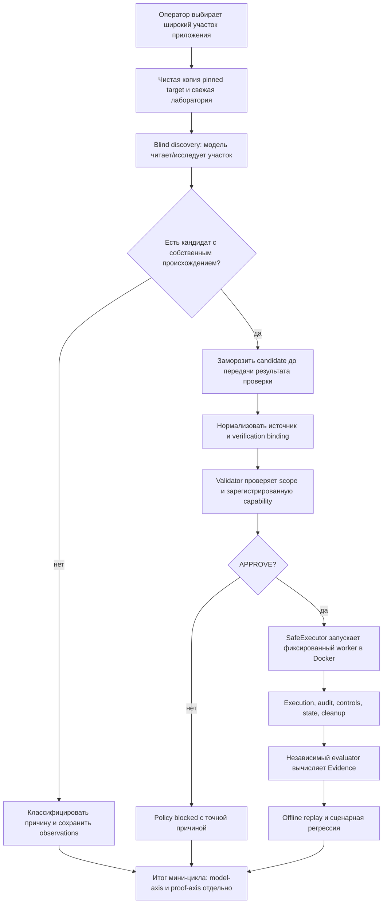

# План: поэтапно улучшить самостоятельный поиск и подтверждение Juice Shop

**Дата:** 16 октября 2026

**Статус:** реализация начата; ниже отмечается фактический прогресс

### Фактическая реализация на 16 октября 2026

- P01: добавлен отдельный blind CLI-режим без SAST-seed, широкие
  operator-owned source profiles, fail-closed фильтрация discovery/source map и
  `blind-manifest.json` с хешами фактически доступной Scout проекции.
- Добавлены регрессии на утечку файлов вне профиля, benchmark/oracle файлов,
  отсутствующие пути и запрет совмещать blind режим с SAST findings.
- P02/P03: реализованы отдельные fixed protocols для role-registration и
  anonymous Product PUT с typed redacted trials, fresh disposable Docker target,
  independent readback, controls, pinned source/worker/profile bindings и
  проверяемой очисткой. Проведено по одной настоящей Docker acceptance-генерации
  на закреплённом Juice Shop; обе завершились `confirmed`, cleanup и source
  integrity прошли. Это protocol acceptance, не обнаружение агентом и не метрика
  A04. Подробности: [`juice-incremental-mini-proofs.md`](juice-incremental-mini-proofs.md).
- Во время acceptance исправлены несовместимая с Docker Desktop настройка
  `max-file=1` и расхождение канонизации generation digest между host и worker;
  добавлена регрессия на одинаковый generation digest.
- P04/P05: добавлены типизированные fixed-proof profile/binding, отдельный
  `verify_juice_proof` policy extension и pinned target profile. Кандидат может
  появиться только при точном совпадении двух зарегистрированных detector rule
  ID и исходного файла; binding создаёт приложение и повторно проверяют Validator
  и Executor. Executor запускает фиксированный Docker protocol без URL/argv от
  модели. Evidence пересчитывает typed trial и требует совпадения persisted
  execution, action digest и audit; cleanup failure/stale source дают отказ или
  `inconclusive`. Добавлены offline regressions на route mismatch, stale source,
  tampered parameters, legacy ActionProposal wire shape, verdict recomputation и
  cleanup failure. Исторические B04/B05 профили не менялись. Живой integrated
  model run ещё не выполнен; это не метрика и не доказательство роста A04.
- Первый blind account-lifecycle запуск выполнен без findings, SAST и benchmark
  labels; profile открыл модели 11 файлов. Запрос остановился после одного вызова
  с provider status `auth_or_access` (класс HTTP 401/403); Scout не успел прочитать
  файл и не создал candidate. Это не отрицательный результат поиска — live-run
  требует рабочего доступа к NSU. Артефакты сохранены в
  `artifacts/juice-incremental-blind-account-2026-10-16/`.
- Проверка текущего состояния: полный `pytest` — 1474 passed, 30 skipped;
  `ruff check` — pass; `python -m app.main` — demo workflow confirmed. Пропуски
  в основном относятся к opt-in Docker acceptance suites; два новых fixed
  protocol acceptance выполнены отдельно на реальном локальном Docker.
- После дополнительной проверки интеграции оба протокола подключены к общему
  campaign runner и offline scorer. Настоящая Docker-приемка канонического
  маршрута дала 2 confirmed; offline replay совпал, cleanup/source integrity
  прошли. Исправлено расхождение формы fixture JSON и Evidence interpreter.
  Приемка: `artifacts/juice-incremental-canonical-acceptance-2026-10-16/`.
- По запросу пользователя начат один общий исследовательский прогон Qwen:
  `artifacts/juice-full-research-2026-10-16/`, budget 1800 секунд, до 64 вопросов,
  256 model calls, total HTTP cap 2048. Новый токен проверен и передан только
  процессу. Прогон завершен по бюджету: 26 исследовательских вопросов,
  182 модельных вызова; один provider failure, `degraded=true`.
  После replay: 13/27 runtime confirmed (48,15%), ранее 11/27. Очистка,
  source integrity и seal 518 файлов проверены. Отчет:
  [`juice-full-research-report-2026-10-16.md`](juice-full-research-report-2026-10-16.md).
  P07/P09 как отдельные blind mini-runs пока не выполнены; по запросу
  пользователя проведен общий seeded campaign.

**Рабочая цель:** увеличить число верно обнаруженных и доказанно подтверждённых случаев в закреплённой версии OWASP Juice Shop, сохранив честный A04 score и воспроизводимые доказательства.

## 1. Коротко: что именно строим

Дальше работаем не длинными сериями изменений с одним финальным сюрпризом, а коротким циклом на одном функциональном участке:

1. Дать модели исследовать участок приложения без готового ответа, точной строки уязвимости и результата сканера.
2. Зафиксировать, что именно модель нашла и на каких фактах основывалась.
3. Отдельно проверить это утверждение независимым детерминированным протоколом в закреплённой Docker-лаборатории.
4. Если модель не нашла проблему — выяснить, где остановилась: не прочла нужный код, не связала источник с обработчиком, не сформировала гипотезу, выбрала неподходящий инструмент или исчерпала бюджет.
5. Исправить только установленную причину, добавить локальную регрессию, повторить короткую проверку.
6. Сохранить каждый исход и его артефакты. После закрытия пакета сделать один широкий итоговый запуск и пересчитать замороженный эталон.

Для каждого случая ведутся **две независимые оценки**:

| Оценка | На какой вопрос отвечает | Что является успехом |
|---|---|---|
| Самостоятельное обнаружение | Назвала ли модель реальное проверяемое свойство до получения результата фиксированного протокола? | Содержательный кандидат создан из собственных наблюдений модели и привязан к точному источнику/поверхности. |
| Подтверждение | Доказывает ли отдельная безопасная проверка именно заявленное свойство? | Валидатор разрешил зарегистрированное действие, исполнитель провёл его в контейнере, а Evidence независимо вычислил вердикт. |

Успех одного контура не засчитывается за успех другого. Фиксированная проверка может подтвердить случай, который модель не заметила; такой результат улучшает покрытие детерминированного подтверждения, но не доказывает качество самостоятельного поиска.

## 2. От чего отталкиваемся

Последний общий проход от 16 октября проверил один и тот же закреплённый корпус: Juice Shop v20.2.0, commit `5658473cf8814459bf89000ce373b20ed0b4eb37`, 27 положительных и 8 безопасных original cases.

- Runtime-confirmed: **11/27 (40,74%)**, было 7/27.
- SAST/source discovery в этом проходе: 27/27 положительных случаев сопоставлены эталону; precision детекции по A04 — 27/28, так как одно наблюдение сопоставилось с безопасным случаем.
- LLM-вызовов в последнем общем проходе было **ноль**. Значит, он ничего не говорит о самостоятельном поиске модели.
- На 8 безопасных случаях не было ни одного бинарного решения. Наблюдаемое число ложных подтверждений — 0/8, но корректность модели на безопасных случаях этим не доказана.
- 16 положительных случаев пока без runtime-confirmed: 15 ждут применимого runtime-протокола или полноценной проверки, один имеет только отдельное source-доказательство.
- Условие CODE-001 в выбранном Docker-образе отключено настройкой auto-safety. Для него нельзя выдавать runtime-confirmed, пока не проверен реальный исполняемый путь.
- Исторический HOLDOUT использовался при разработке. Его нельзя представлять независимым финальным тестом.

Итоговый отчёт и таблица по всем случаям: [`juice-all-ready-verification-report-2026-10-16.md`](juice-all-ready-verification-report-2026-10-16.md). Здесь предлагается следующий инженерный цикл; исходный A04, его метки, matcher и seals остаются неизменными.

## 3. Критерии, которые нельзя размывать

### 3.1. Что значит «модель сама нашла»

Кандидат засчитывается как найденный моделью только если до фиксированной проверки в сохранённом следе есть:

- наблюдение модели, полученное через разрешённый инструмент чтения исходника или контролируемый просмотр поверхности;
- гипотеза, которая описывает реальное свойство, а не просто повторяет имя endpoint, detector или строку из эталона;
- привязка к первичному source anchor или к наблюдению поведения;
- указание на ожидаемое влияние и на то, что ещё нужно проверить;
- корректное происхождение: какие чтения/запросы привели к кандидату.

Не считается самостоятельным обнаружением:

- finding был передан модели из SAST, source detector, gap report, A04 catalog, прежнего отчёта или seed-очереди;
- модели сообщили ID случая, точный дефект, уязвимую строку, ожидаемый payload либо готовое имя проверочного протокола;
- оператор после проверки вручную написал кандидат за модель;
- скриптовая фикстура в тесте заранее вернула нужный candidate. Это проверяет wiring, но не способность модели искать.

### 3.2. Что значит «подтверждено»

`confirmed` допустим, только если одновременно выполнено всё:

1. `ActionProposal` относится к операторски зарегистрированному target, свойству, маршруту и поколению лаборатории.
2. Валидатор независимо проверил полномочия, scope, параметры, budget и binding.
3. SafeExecutor выполнил только зарегистрированную capability в Docker-среде.
4. Записаны approval digest, execution, аудит, source/runtime identity, контрольные запросы, состояние до и после, cleanup.
5. Независимый evaluator проверил именно свойство гипотезы, а не только HTTP status, текст ответа, отсутствие блокировки или вывод LLM.
6. Для отрицательного вывода есть исправный baseline/control; отказ из-за timeout, ошибки среды, неверной учётной записи или сломанной фикстуры означает `inconclusive`.

Значение `rejected` требует, чтобы проверка была пригодной и завершилась явным противоречием гипотезе. «Ничего не нашли», исключение, недоступный endpoint, недостаточный бюджет и отсутствие подходящего протокола — не `rejected`.

### 3.3. Результаты каждого мини-цикла

На каждый мини-цикл сохраняется один из следующих статусов для каждой оси:

| Статус | Значение |
|---|---|
| `model_found` | Содержательный кандидат создан моделью до проверки и связан с её наблюдениями. |
| `model_not_found` | Полноценный ограниченный исследовательский проход завершён, кандидат не создан. |
| `model_unbound` | Модель заметила риск, но не привязала его к нужному source/route/property. |
| `model_incomplete` | Исследование не завершено из-за provider, budget, schema или runtime ошибки. |
| `verification_confirmed` | Валидированное независимое Evidence доказало заявленное свойство. |
| `verification_rejected` | Исправная проверка опровергла гипотезу. |
| `verification_inconclusive` | Проверка выполнена, но доказательств для одного из вердиктов не хватило. |
| `verification_not_available` | Для свойства ещё нет зарегистрированной проверки. |

Мини-цикл — диагностический эксперимент на известном development corpus. Он **не является новым независимым A04 измерением** и сам по себе не обновляет benchmark-метрики.

## 4. Безопасная схема потока



Критическая граница: до заморозки candidate модель не получает ответ протокола. После заморозки кандидат можно передать уже существующему мосту проверки. Весь обычный workflow по-прежнему идёт через `ActionProposal → Validator → SafeExecutor → Evidence`.

## 5. Как сохранить слепой поиск

### 5.1. Вход модели

Для мини-цикла создаётся чистый run и новая папка результатов. Модель получает:

- pinned source inventory, нумерованные ограниченные окна кода, `related_files` и, если есть пригодная карта маршрутов, только обычную route/handler map;
- возможность попросить дополнительные source windows и literal symbol/route searches через Scout; каждый ответ привязан к фактически прочитанному файлу и диапазону;
- широкий исследовательский вопрос по функциональному участку, например «проверь границы доступа к операциям с товарами» или «проследи создание учётной записи и использование назначаемых полей»;
- фиксированные ограничения по числу turn, объёму исходников, кандидатам и wall time.

Текущий `RepositoryScout` **только читает исходный код**; он не запускает модельные скрипты и не делает target HTTP проверки. Если модели понадобится безопасный эксперимент, candidate сначала запечатывается, затем отдельный `ResearchAgentModel` run может использовать уже существующий bounded ResearchRuntime (networkless script workspace и зарегистрированный internal `target_http` worker). Любой такой эксперимент идёт через Validator/Executor и считается этапом проверки гипотезы, не первичным Scout discovery. Не добавлять Scout прямой произвольный HTTP или выполнение кода на host.

Самостоятельное source-discovery запускается текущим `app.scout` / `RepositoryScout` **без** `--sast-findings`. У этого входа нет finding seed. В режиме blind run запрещено подключать baseline findings, объединять Scout с SAST очередью или запускать campaign preverification до заморозки candidates. Текущий `app.scout` строит source map без oracle controllers и vulnerability regions; этот фильтр и список индексируемых файлов надо включить в manifest и проверять до каждого run.

Чтобы работать последовательно по одному домену, добавить operator-owned **широкий surface profile** (например, `accounts-and-registration` или `catalog-write-paths`) с перечнем модулей/папок и обычных соседних handlers. Профиль не содержит case ID, expected vulnerability, точный line/anchor, payload и protocol id. Он позволяет запускать короткое source exploration только по соответствующему функциональному домену, не повторяя полный CI pipeline. Поскольку ограничение области уже направляет поиск, результат каждого такого прогона помечать `targeted_development_run`, а не измерением full-project model recall.

В этом режиме модель **не получает**:

- `JS-*` ID и split эталона, scorer, A04 positives/safes, список незакрытых метрик;
- результат SAST, source-detector finding, gap audit, прошлый отчёт по конкретной проблеме;
- точный ожидаемый endpoint, vulnerable anchor, payload, роль, sentinel или готовое описание доказательства;
- идентификатор/описание fixed protocol, которое подсказывало бы искомый дефект.

Оператор заранее знает ожидаемый случай, чтобы построить проверку, но его знание не попадает в запрос модели. В логах сохраняются точные, отредактированные от секретов сообщения модели, хеши исходного prompt/context и все tool events, чтобы можно было проверить отсутствие подсказки.

### 5.2. Как выбрать область, не подсказать ответ

Область задаётся на уровне функционального домена, а не конкретной ошибки: например «учётные записи и управление профилем», а не «можно ли назначить admin через поле role». В одном домене могут быть несколько кандидатов и безопасные участки.

Поскольку это целевая диагностика на известной версии, результат маркируется `targeted_development_run`. Для честной проверки самостоятельного поиска в конце нужен один широкий проход без точечных задач, без seeded candidates и без прямой передачи тестового сценария. Если модель на узком вопросе нашла дефект, это полезный сигнал для разработки, но его нельзя выдавать за слепую оценку общего recall.

### 5.3. Разделить источник и runtime поверхность

Для каждого мини-цикла есть два режима и два результата:

- **Blind discovery**: `RepositoryScout` исследует разрешённый участок, генерирует candidate и фиксирует source provenance. Это проверяет source discovery.
- **Fixed proof**: операторский protocol проверяет конкретное свойство в отдельной disposable fixture. Это проверяет evidence/verification.

При необходимости между ними существует дополнительная `candidate investigation` фаза через `ResearchAgentModel`: она получает уже сформированный и сохранённый candidate, собирает дополнительные наблюдения и планирует разрешённые действия. Её calls/actions записываются отдельно. Она не может превратить candidate, переданный извне, в `model_found`.

При необходимости отдельно выполняется **source-only review**. Он сохраняется как source-level finding и никогда не прибавляется к runtime-confirmed recall. Например, наличие MD5 в цепочке хранения пароля и доказанное получение хеша через runtime API — разные утверждения и разные evidence.

## 6. Изменения в реализации: сделать один повторяемый мини-цикл

Имена ниже описывают планируемую доработку существующих модулей. Это не распоряжение создавать второй параллельный агент, другой schema layer или обходить основную графовую цепочку.

### 6.1. Точки интеграции

Использовать текущие компоненты:

- `agent/repository_scout.py::RepositoryScout` и `app/scout.py` — первичный self-discovery из source inventory без finding seed;
- `agent/research.py::ResearchAgentModel` — исследовательские шаги и модельные кандидаты;
- `schemas/research_agent.py` — `ResearchCandidate`, `ResearchTurn`, `ResearchChoice`, `ResearchLimits`, `ResearchProgress`;
- `app/research_run.py::run_research` — отдельный source-focused run с сохранением событий и progress;
- `app/research_campaign.py::campaign` — только для итоговой интеграции с очередями SAST/источников;
- `pipeline/research_fixture_verification.py` — выбор существующего protocol после фиксации candidate;
- `security/access_verification.py`, `schemas/verification_binding.py`, `schemas/target.py`, `policies/b05-access.yaml`, `validator/validator.py` — закрытый реестр действия, маршрута и binding;
- существующие Docker fixture lab, fixed workers, typed evidence evaluators, approval/audit replay, scorer и seal-пакетирование.

Мини-runner нужен только если текущий CLI не умеет надёжно выполнить последовательность «blind run → остановиться и сохранить candidate → operator review → exact proof». Его интерфейс должен вызывать канонические `run_research` и текущий verifier, а не иметь собственный Executor или статусный evaluator.

**Развести входы двух существующих модельных контуров.** `app.scout`/`RepositoryScout` подходит для оценки, создала ли модель candidate самостоятельно: он получает проектный source inventory и не требует `Finding`. `ResearchAgentModel` внутри `app.research_run` — контур исследования уже существующего finding; его `run_research(..., finding=...)` не годится для model-only discovery, если `finding` пришёл из SAST, benchmark или оператора с готовым ответом. Его можно использовать после Scout-кандидата для построения безопасного плана и проверки гипотезы, но этот результат считать продолжением candidate investigation, а не самостоятельным обнаружением.

Если текущий Scout нельзя ограничить широким surface profile без передачи точных oracle anchors, добавить только операторский allowlist исходных модулей до запуска. Если `ResearchAgentModel` необходим для экспериментальной проверки, связывать его с уже запечатанным candidate и затем вести ту же Validator/Executor/Evidence цепочку. Не создавать фиктивный уязвимый `Finding` «для запуска» модели и не называть такой запуск blind.

### 6.2. Предлагаемый интерфейс запуска

Сначала использовать `app.scout` для source-discovery; если ему недостаёт surface scoping и согласованного manifest, добавить небольшой операторский wrapper (рабочее имя `app.juice_scenario_acceptance`) с двумя независимыми подкомандами:

```text
blind-discovery --target <pinned checkout> --surface-profile <широкая функциональная область>
  --output-dir <новая папка> --max-turns <лимит> --max-source-chars <лимит>
  --wall-clock-seconds <лимит> --max-candidates <лимит>

fixed-proof --profile <зарегистрированный target profile> --candidate <sealed candidate>
  --scenario <operator scenario id> --output <новая папка>
```

Правила интерфейса:

1. `blind-discovery` не принимает scenario ID, preliminary findings, anchors, SAST/DAST observations или benchmark rows. Он запускает Scout с широким surface profile и запечатывает каждый candidate и provenance. Scout turn/source/wall/candidate limits явно записываются в manifest.
2. `fixed-proof` вообще не вызывает модель и принимает только candidate, замороженный до проверки, затем отдельный operator scenario id и разрешённую binding.
3. Candidate-to-scenario mapping выполняется после discovery seal. Если оператор выбрал другой сценарий, зафиксировать `unmatched`/`out-of-scope`, а не подменять кандидат.
4. Не возвращать verifier verdict в активную Scout transcript. Исследование и fixed proof — две команды/фазы с отдельными logs.
5. Каждый запуск использует уникальный пустой output directory. Нельзя тихо дописывать новую попытку в старую папку или затирать предыдущий sealed результат.
6. CLI выдаёт понятный status report и ссылки на артефакты, но не считает новый A04 score. Если после candidate нужен `ResearchAgentModel`, для него задаются отдельные `ResearchLimits`; его вызовы и действия не смешиваются с показателями Scout discovery.

Если отдельный CLI оказывается излишним, те же режимы можно выразить уже существующими CLI и операторскими config files. При этом контракт раздельных фаз, артефакты и тесты остаются обязательными.

### 6.3. Не передавать benchmark truth в run state

Перед первой live-model проверкой выполнить code review границ данных:

- Source inventory не перечисляет каталог тестов, solutions, benchmark JSON, `evaluation/positive_catalog.py`, gap audit и сохранённые report folders.
- В `ResearchAgentModel` не сериализуются finding IDs, split labels, expected detector families или protocol routing IDs.
- `surface_context` содержит широкое описание домена, а не готовые routes/expected properties.
- Не передавать SAST/source-detector очередь и не включать campaign preverification в discovery-mode.
- Если модели нужен HTTP, её разрешения задаются узкими operator-owned grants и фиксированным worker. Модель не получает пароль, bearer token, user ID, произвольный URL или возможность менять scope.
- Все найденные prompt-injection строки в коде/HTTP остаются недоверенными данными; инструменты не интерпретируют их как правила исполнения.

Нельзя использовать A04 labels для управления исследованием или предоставлять gap evaluator в качестве подсказчика. Он остаётся только внешним оценщиком после запечатывания попытки.

## 7. Общая последовательность на один случай

### Фаза A — паспорт свойства и протокола

До live вызова модели оператор/разработчик фиксирует в private operator record:

- точное свойство приложения, которое оценивается;
- positive setup, safe/availability control и восстановление начального состояния;
- разрешённые методы, endpoint scope, identities и объекты;
- какие статусы/состояния являются доказательством, а какие только симптомом;
- что должно сделать Evidence, чтобы выдать `confirmed`, `rejected` или `inconclusive`;
- ожидания к source binding и связь с A04 — в evaluator-only файле, который не передаётся модели.

Для каждого writable протокола до модельного эксперимента проверить, что тест меняет только одноразовые данные/учётку, умеет читать состояние независимо от исходного ответа и гарантированно очищает свою среду.

### Фаза B — фиксированная проверка без LLM

Сначала проверить протокол как отдельную компоненту, чтобы отладка модели не маскировала ошибку worker:

1. Provision pinned target и новую disposable fixture.
2. Пройти валидное действие только через Validator и SafeExecutor.
3. Проверить положительный, отрицательный, health/identity и reset controls.
4. Независимо прочитать эффект; валидировать конкретный property, identity и generation.
5. Перезапустить offline verifier на запечатанных execution/audit. Результат обязан совпасть.
6. Проверить cleanup и целостность pinned исходников.

Этот этап подтверждает только работоспособность протокола. Он не считается обнаружением моделью и не повышает benchmark score до общего sealed run.

### Фаза C — blind discovery модели

1. Создать чистый source-only/model run без scanner queue и ответов.
2. Дать широкий вопрос по участку и ограниченные read/search/script tools.
3. Ограничить число шагов и модельных вызовов, сохранить каждый tool input/output и расходы.
4. Требовать от каждого кандидата доказуемые observation refs, фактическое чтение исходника/поверхности и понятное описание свойства.
5. Отбросить кандидат, если cited observation отсутствует, read anchor не совпадает, источник вышел за scope или утверждение шире фактов.
6. Закрыть run, сохранить исходный кандидат и хеши до fixed proof.

Если provider не ответил, схема невалидна, чтение запрещено политикой или исчерпан budget, исход — `model_incomplete`, а не `model_not_found`.

### Фаза D — exact binding и независимая проверка

1. Связать candidate с зарегистрированным `handler_id`, service, endpoint, method, check ID и точным source anchor.
2. Если соответствие неоднозначное или helper/neighboring source не является первичным sink, остановиться как `unbound`/`inconclusive`; не выбирать первый маршрут.
3. Валидатор повторно проверить весь binding и полную `ActionProposal` digest.
4. Запустить fixed worker, проверить controls, persisted Evidence и cleanup.
5. Только затем раскрыть результат mini-run evaluator и сопоставить с ожидаемым свойством.

Если модель предложила иное реальное свойство, его не следует искусственно подгонять под ожидаемый A04 case. Сохранить его как новый candidate вне замороженного score и отдельно решить, нужен ли review.

### Фаза E — причина сбоя и минимальное улучшение

Если одна из осей не прошла, записать причину в одной из категорий:

```text
source discovery gap
source-to-handler mapping gap
hypothesis quality gap
candidate schema/provenance rejection
tool planning or parameterization gap
permission/policy denial
fixture/protocol defect
Evidence evaluator defect
budget/provider/schema/runtime failure
safe control or cleanup failure
```

Дальше исправить самый ранний сломанный участок. Примеры:

- Код обработчика был в inventory, но не прочитан → улучшить source navigation/coverage, не добавлять точный ответ в prompt.
- Нужная функция найдена, но candidate не связан с route → улучшить route/AST binding общим правилом и добавить regression на соседний/неверный handler.
- Model proposal корректен, Validator отверг узкое действие → исправить операторский grant/registry, не ослаблять scope policy.
- Фиксированный worker прошёл, а Evidence выдал inconclusive → исправить независимый readback/evaluator; не объявлять protocol success по логу worker.
- Точный баг оказался недоступен из-за закреплённого runtime feature flag → не включать сценарий в образ ради метрик; пометить ограничение, оставить score и решать только по отдельному утверждённому target profile.

После исправления: focused unit/regression → один короткий `fixed-proof` → один новый blind attempt на ту же широкую область. Обе попытки сохраняются. Нельзя удалять неудачную, менять её prompt/outputs задним числом или выбирать только лучший исход.

### Фаза F — закрытие мини-цикла

Пакет считается закрытым, когда:

- discovery и proof axes имеют отдельные статусы и понятные причины;
- approved action и evidence соответствуют exact binding;
- отрицательный/healthy контроль исправен;
- replay, audit, generation и cleanup проходят;
- есть regression для найденной ошибки и хотя бы одной правдоподобной неправильной привязки;
- сохранён redacted sealed package с source/config/prompt/runtime hashes и без секретов;
- отчёт содержит попытки, budget, provider/model/version, duration, status и ограничения.

Если после двух содержательных blind attempts модель не находит риск, фиксируем `model_not_found` и диагностический bottleneck. Разрешено менять общий процесс чтения/планирования, но после существенного изменения предыдущая попытка не переименовывается в успех: создаётся новый run. Prompt tuning по точному эталонному ответу переводит дальнейшую оценку в development-only и исключает её из заявления о blind discovery.

## 8. Приоритет случаев и протоколы

Последовательность ниже учитывает не только потенциальный прирост Recall, но и безопасность, диагностическую ясность и возможность строить повторно используемые проверки. `A04 ID` — только внутренний ключ, он никогда не попадает в модельный blind prompt.

### Пакет 1. Авторизация и назначение роли

#### Случай `JS-AUTHZ-001`: неавторизованное изменение продукта

Исходный код показывает, что `PUT /api/Products/:id` не имеет активного `security.isAuthorized()` middleware, хотя соседние маршруты имеют явную политику. Это source observation, а не готовое runtime-доказательство.

План proof:

1. Подготовить через обычный разрешённый пользовательский путь два **новых** синтетических товара, чей ID создан самой fixture. Не менять seeded товары.
2. Положительный контроль: аутентифицированный владелец меняет один синтетический товар; отдельный GET подтверждает типизированное изменение.
3. Основной probe: выполнить разрешённый anonymous PUT по другому одноразовому товару с безопасным маркером/типизированным полем, затем отдельным запросом перечитать товар.
4. Передачи товара модели нет; известные ID, токены и sentinel остаются только в worker tmpfs. Не применять script-generated arbitrary URL.
5. Контроль публичного чтения не считать разрешением на запись. Дополнительно использовать точно зарегистрированный защищённый write-control на принадлежащей fixture записи, если API и ownership уже подтверждены. Если control не может быть надёжно построен, оставить его ограничение явным и не выдавать `rejected` по одному отказу.
6. Сравнить identity, generation, исходные и конечные данные, все ответы, аудит и cleanup. Отдельно убедиться, что поля вне изменяемого разрешённого набора остались прежними.

Confirmed означает только: «анонимный запрос изменил созданную для этой проверки запись каталога, и изменение независимо прочитано». Он не доказывает ущерб к seeded каталогу, privilege escalation или impact на пользователей.

#### Случай `JS-AUTHZ-002`: регистрация с повышенной ролью

`User.role` допускает фиксированные значения, включая `admin`; правило валидации модели само по себе не доказывает, что публичная регистрация присваивает его пользователю.

План proof:

1. Создать чистую одноразовую учётную запись baseline без поля role и убедиться, что после нового login её роль обычная.
2. Создать отдельную одноразовую учётную запись candidate, запросив допустимое повышенное значение role. Не использовать и не менять seed admin.
3. Независимо выполнить новый login candidate и прочитать только собственную идентичность через выделенный fixed worker. Расширить существующую проверку identity отдельным типизированным результатом, не ослабляя `AccessFixtureLab.identity()` который сегодня ожидает customer для B04.
4. Не считать HTTP 201, эхо request body или `role` в первоначальном ответе доказательством. Нужна роль из независимого authenticated readback после повторной авторизации.
5. Контроль: baseline account остаётся обычной ролью, обе учётки действительно могут войти, source/fixture generation совпадают.
6. Не выполнять произвольные admin-действия. Если отдельное безопасное admin-only действие нужно для оценки реального эффекта, сначала определить read-only контроль с ограниченным влиянием и отдельным owner grant; это самостоятельная проверка с собственным Evidence.

Confirmed ограничивается «публичный путь регистрации создал учётку с повышенной сохранённой ролью». Это не утверждение о любом admin API и не разрешение модели использовать admin capabilities.

Оба случая внедрять отдельными изменениями. Общими могут быть private account lifecycle, redacted identity readback и evidence helper; протоколы и claim scopes остаются разными.

### Пакет 2. NoSQL selector и типизированные ограничения

#### `JS-NOSQL-002`: селектор заказа

- Сначала прочитать точный handler/ORM query и route binding; обнаружить только в широком домене работы с заказами.
- Поднять две одноразовые записи одной fixture identity, чей ownership подтверждён независимым baseline.
- Применить ограниченный JSON selector к тестовой операции. Не сканировать базу, не пробовать операторный fuzzing и не читать данные других пользователей.
- Сохранить доказательство, что селектор изменил/вернул только предусмотренные одноразовые объекты и что обычный scalar selector сохраняет baseline.
- Передать в Evidence только типизированные counts/hashes/ownership refs, не произвольные документы и приватные order данные.
- При неоднозначном эффекте, ошибке identity или изменении чужой записи — остановка, cleanup и `inconclusive`/технический сбой.

#### `JS-BIZ-001`, `JS-BIZ-002`: количество и купон

- Изучить существующие корзинные write protocols и опираться на один owned basket, отдельную учётку и реальный state readback.
- Для отрицательного количества проверить тип, допустимый диапазон, изменение subtotal и инварианты общей суммы; не использовать дорогостоящие purchase/payment действия.
- Для купона использовать только зарегистрированный тестовый код fixture, baseline без купона и независимый readback скидки/итога. Не угадывать или перечислять реальные купоны.
- В каждом тесте сравнивать before/after и позитивный нормальный purchase-preview control. Не переходить к завершению заказа, отправке платежа или изменению общего каталога.
- До implementation письменно определить ожидаемую семантику калькулятора по исходникам/закреплённой версии; не выводить verdict из того, что сумма «кажется странной».

### Пакет 3. Путь, файл, SSRF и XXE

#### `JS-FILE-002`: нормализация имени файла

- Создать безопасный тестовый файл с уникальным harmless marker внутри lab tmpfs; никакого доступа к host paths.
- Проверить только зарегистрированный upload/download path и ограниченные формы имени. Сверять хеш файла внутри отведённой директории и проверять, что путь не покинул fixture root.
- Проверить нормальное имя как positive functional control и traversal-like имя как отдельно маркированный тест.
- В Evidence не включать содержимое файлов, абсолютный путь хоста или внешние директории. Cleanup удаляет только собственную test generation.

#### `JS-PATH-001`: traversal/containment

- Сгенерировать архив или файл только внутри disposable tmpfs и записать marker в двух контролируемых местах.
- Worker связывает каждый путь с canonical fixture root и доказывает, где marker доступен. Проверка не читает `/etc`, host filesystem, другие контейнеры и сетевые ресурсы.
- Обязательные controls: обычный относительный путь доступен, запрещённая форма не раскрывает marker вне целевого root, lab generation остаётся неизменной.
- Если корень/нормализация неоднозначны или нет независимого безопасного readback, результат inconclusive.

#### `JS-SSRF-001`: запрос только в локальный sink

- Использовать фиксированный operator-registered sink на отдельной внутренней Docker-сети; модель не получает arbitrary URL, DNS, host gateway или интернет-доступ.
- Передать уникальный маркер через штатное поле тестового объекта; sink фиксирует только факт и digest запроса.
- Проверить baseline запроса без callback и вариант на зарегистрированный sink; запретить redirects наружу и блокировать egress.
- Evidence подтверждает доставку в sink из нужного target generation, а не просто успешный ответ приложения или текст в логе.

#### `JS-XXE-001`: локальная XML entity

- Принимать только одну фиксированную harmless XML fixture с внутренним marker, не произвольные файлы/URL модели.
- Worker/source adapter доказывает, что parser разрешил/попытался разрешить именно internal entity, но ни один внешний fetch не состоялся.
- Контроль — тот же XML с отключенной/обычной entity, плюс проверка сетевой изоляции.
- Не читать host files, secrets, контейнерные credentials и не использовать внешние DTD. Подтверждение ограничено обработкой тестовой внутренней entity.

### Пакет 4. Браузерные и клиентские свойства

#### `JS-XSS-001`, `JS-XSS-002`

- Запускать закреплённый browser image в disposable network namespace; пользоваться только synthetic account и собственными товарами/полями.
- Для stored XSS worker принимает безопасный уникальный маркер в закрытом test record и проверяет execution через browser instrumentation без вывода/выполнения настоящего вредоносного кода.
- Проверять кодированное значение как negative control; смотреть DOM/context/observable test marker, не принимать буквальное наличие строки в HTML за XSS.
- Отключить внешнюю сеть. Никакого доступа к чужим данным, session storage, clipboard, профилю пользователя или browser host.
- Для edit product создавать собственный synthetic product и удалять его reset generation. Отдельно хранить `JS-XSS-001` и `JS-XSS-002`, пока не доказано, что их source/trigger/effect совпадают.
- Если для демонстрации выполнения нужен sandboxed harmless callback, он должен быть заранее написан фиксированным browser worker, а не создан моделью и не запускать произвольный payload.

### Пакет 5. CAPTCHA, rate limit и metrics

#### `JS-CAPTCHA-001`

- До создания протокола определить точное утверждение эталона: раскрытие challenge answer, повторное использование, отсутствие серверной проверки или другое. Название/ответ API сам по себе не доказывает bypass.
- Измерять только этот узкий claim на test account и фиксированном числе запросов. Не выполнять нагрузочный тест и не создавать обход большого количества challenge.
- Сравнить непройденный challenge, валидное завершение контрольного challenge и повторный/изменённый тестовый challenge; ограничить объём one-shot operations.
- Если expected security property из A04 невозможно однозначно интерпретировать на закреплённом runtime, зафиксировать scope mismatch и оставить case unresolved; не выбирать удобное свойство задним числом.

#### `JS-RATE-001`

- Сначала прочитать rate-limit implementation и прокси-конфигурацию внутри контейнера; выяснить, какую identity key реально учитывает limiter.
- Выполнять минимальную последовательность запросов до и после небольшого порога на закрытой тестовой операции/учётке. Никаких volumetric нагрузок или lockout реальных аккаунтов.
- Контроль: запросы с той же identity ограничиваются предсказуемо; допустимое изменение только зарегистрированной test identity демонстрирует именно заявленную ошибку ключа/обхода, если она есть.
- Evidence содержит малые счётчики, задержки bucket и идентификаторы generation, но не раскрывает клиентские токены/адреса.

#### `JS-DATA-002`: раскрытие metrics

- Не считать имя `metrics` доказательством чувствительности или публичности. Сопоставить route, guard, отдаваемые поля и подтверждённый expected claim из паспорта случая.
- Проверить доступ без auth и через обычный account только к локальному закреплённому endpoint; response редактировать до заранее разрешённых ключей.
- Control: зарегистрированный защищённый endpoint отвечает отказом anonymous и успешным ограниченным запросом fixture role. Не использовать admin config route по названию: текущий `GET /rest/admin/application-configuration` не показывает видимого admin guard в `server.ts` и не является подходящим control.
- Evidence доказывает именно наличие выбранных чувствительных полей для неавторизованного субъекта. Если fixture не может доказать чувствительность/ожидаемую политику полей, оставить inconclusive.

### Пакет 6. Source-only криптография и неподдерживаемая code ветка

#### `JS-CRYPTO-001`

- Сохранять две независимые классификации: source claim (например, MD5 используется в цепочке password storage) и runtime disclosure (например, API возвращает hash).
- Source review привязывает AST/data-flow к exact source snapshot и цепочке вызовов, показывает отсутствие/наличие соли/современной password KDF только если это можно детерминированно установить.
- Source-confirmed не повышает runtime-confirmed 11/27 и не смешивается с Source/SAST и runtime Recall.
- Не раскрывать пароль, hash реального пользователя или токен в LLM input/output/report.

#### `JS-CODE-001`

- Сначала подтвердить runtime feature flags, config digest и доступность ветки в закреплённом image. Текущая ветка отключена auto-safety.
- Не менять образ, флаги, условия активации или challenge, чтобы заставить кейс пройти и получить подтверждение.
- Если условие недостижимо в frozen target, статус для этой метрики — `unsupported_runtime`/not evaluable с доказательством конфигурации. Отдельное исследование включённой ветки возможно только в отдельном явно обозначенном lab profile; оно не подменяет исходный A04 case.

## 9. Реестр, grants и тестовая поверхность

Для каждой новой проверки расширять закрытые contracts согласованно. Сначала проверить, что уже может выразить текущий schema, и добавлять минимальные поля только при необходимости.

Ожидаемые места согласования:

1. `schemas/verification_binding.py`: допустимый `check`, `tool`, `method`, `family` и typed source selector.
2. `schemas/target.py::TargetProfile.validate_mapping_keys`: разрешённые пары endpoint/method/family/check; неизвестные пары должны по-прежнему отклоняться.
3. `targets/juice-b05-access-fixture.yaml` или профиль-специалист: операторский маршрут/role/fixture generation. Не менять исторические lock-файлы.
4. `policies/b05-access.yaml` и `validator/validator.py`: точное закрытое разрешение. Никакого общего wildcard для `/api/*`, ролей, HTTP methods, users или write operations.
5. `schemas/research_fixtures.py::ResearchFixtureGrant`: узкий protocol id, explicit per-protocol budget и wall-time ceiling. Никакого model-selected grant.
6. Фиксированный worker в `executor/` и его wrapper: отдельная private state machine, credentials только в контейнерном tmpfs, отсутствие произвольных shell/URL/host paths.
7. Типизированная schema результата и evaluator в `schemas/`, `evidence/` либо соответствующем существующем модуле: исходы вычисляются из полей worker плюс persisted approval/audit, а не из model text.
8. `pipeline/research_fixture_verification.py`: регистрация одного точного маршрута от подходящего candidate к worker.
9. Тесты: schema, route mapping, Validator allow/deny, worker protocol, Evidence, audit/replay, budget, source mutation, cleanup и end-to-end opt-in.

Всю цепь рассматривать как одну единицу review. Если изменён лишь worker, но его check ID не проходит `TargetProfile` или Validator, это не готовый сценарий. Если action проходит, но Evidence не сверяет independent readback, это также не готово.

### Базовые неизменяемые границы

- Сохранять исторические A01–A08, A04 labels/matcher, B01–B09 sealed records и default policy. Новые проверки включать только через новую operator-owned registration/config.
- Не добавлять model capability для provisioning/reset, создания ролей, произвольного HTTP, shell на host, изменения целевого image или benchmark labels.
- Не ослаблять generic `sandbox_command` network restrictions и не добавлять в ResearchRuntime прямой transport к target.
- Model state не хранит live session broker, tokens, password, fixture object IDs или произвольные URLs.
- Уникальные IDs/markers создаёт worker из generation; worker сам выбирает только зарегистрированные пути и поля.
- Утверждение Evidence должно быть не шире проверяемого свойства. Source condition, reachable route, runtime effect и бизнес-ущерб — разные claims.

## 10. Тест-план перед каждым live mini-run

Локальные deterministic tests должны закрыть как минимум:

### Schema, routing, binding

- корректный exact route разрешается; неизвестные method/check/endpoint/family отклоняются;
- source anchor, line range, handler и binding принадлежат правильному primary sink;
- соседний handler, creation/update mix-up и helper-only source не подтверждают ошибочный candidate;
- смена source/profile/map/generation после approval даёт denial/inconclusive;
- candidate с чужим observation ID, отсутствующим `read_anchor`, непокрытым source или широкой неподтверждённой формулировкой отбрасывается.

### Validator/Executor

- без approval, с неверным action digest, подменённым tool или параметром — denial;
- HTTP method, endpoint, field, object, target role и retry count outside fixed registry не запускаются;
- неизвестный fixture id, stale generation или неверная identity блокирует выполнение;
- budget резервируется до mutation; недостаточный бюджет переводит в pending/blocked до выполнения;
- worker запускается только в disposable Docker, сеть/egress соответствуют profile, host-файлы недоступны.

### Evidence и controls

- HTTP 200 без ожидаемого persisted state не равен confirmed;
- отражённый request JSON/response body не равен independent readback;
- неправильный role/account, login failure, control failure, timeout и неверное поколение — inconclusive;
- identity lost/swapped между шагами не может подтвердить эффект;
- перед/после сохраняется только redacted typed state; credentials, raw tokens и sensitive body не попадают в artifacts;
- противоречивые trials или неполный ledger не дают confirmed;
- успешный offline replay совпадает с исходным verdict и обнаруживает подмену audit/evidence.

### Исследовательский mini-run

- проверить, что SAST, detector candidates, `evaluation/positive_catalog.py`, gap report, A04 row и protocol metadata не попали в prompt, model state и tool outputs;
- проверить, что candidate хранит observation refs и exact source provenance;
- scripted/mock ResearchAgentModel допускается как wiring/regression, но acceptance report помечает его `scripted=true`, а не `model_found`;
- в live run candidate seal создаётся до fixed verification; tool result протокола не попадает обратно в ту же discovery transcript;
- schema correction/ретраи ограничены; каждое исправление сохраняет исходную попытку;
- отсутствие provider generation отражается `model_incomplete`, без имитации содержательного результата.

Для каждой новой capability добавить focused deterministic suite. Полный pytest, Ruff и opt-in Docker end-to-end выполняются по критериям merge из `AGENTS.md` на этапе реализации, но не в ходе написания этого плана.

## 11. Бюджет, время и повторные попытки

Цель короткого цикла — быстро локализовать сбой, а не увеличить количество запросов.

### Стартовые лимиты двух модельных фаз

Для `RepositoryScout` использовать существующие лимиты его интерфейса и сначала ограничить каждый функциональный домен так:

```text
max_turns:             6–8
max_source_chars:      60 000–100 000 символов (после проверки, что релевантный домен целиком помещается)
max_candidates:        8–16
wall_clock_seconds:    180–240
model calls:           не больше числа turn плюс явно учтённые provider retries
```

Каждый Scout turn выполняет модельный запрос; нельзя планировать 12–18 независимых calls при лимите в 6–8 turns. Перед установкой низкого source budget сверить `indexed_lines` и coverage профиля: если нужные модули не попали в окна, результат — `model_incomplete/coverage_limited`, а не `model_not_found`.

Если после candidate нужен ограниченный `ResearchAgentModel` investigation, отдельный стартовый профиль по его `ResearchLimits`:

```text
max_steps:                6–10
max_model_calls:          12–18
max_proposal_corrections: 1–2
max_context_bytes:        48–64 KiB
wall_clock_budget:        120–240 seconds
```

Эти значения — верхние инженерные ceilings для первой реализации, а не обещание фактической длительности. Discovery и investigation расходы учитываются отдельно. Между HTTP/actions ведётся отдельный ledger. Provider timeout, rate limit или 401 дают понятный incomplete и останавливают текущую фазу; не повторять пачку запросов вслепую.

### Лимит на фиксированную проверку

- Сначала расписать полный протокол: setup, baseline, primary, independent readback, control, teardown.
- Зарезервировать максимум ожидаемых HTTP/executor действий до начала изменения состояния.
- Использовать текущие per-protocol grants и lifecycle reservations; не назначать всем новым тестам общий потолок без расчёта.
- Выпускать неиспользованный резерв только когда ledger и terminal Evidence полностью согласованы, как у текущей budget integration.
- Не выполнять check, если бюджет не покрывает завершение, контроль и cleanup.

### Правила retry

- Live модель — не более двух коротких blind попыток на текущую prompt/tool configuration до root-cause review.
- Повтор после provider/transport сбоя может быть один раз, только если ошибка явно временная и первая попытка не выполнила внешних мутаций. Создаётся новый run ID.
- Любое изменение prompt, inventory, tool budget или source projection получает новый конфигурационный digest и новый run; прошлый результат остаётся в серии.
- Когда две корректные попытки сходятся к `model_not_found`, остановить tuning этого точечного случая и выбрать общий bottleneck (coverage, navigation, schema, tool feedback). Затем проверить улучшение на нескольких доменах, а не вписать готовый A04 ответ в prompt.

Не обещать пользователю точное время до первых реальных мини-циклов. Ранее измеренные 123 секунды относятся к verification-only проходу без LLM и не прогнозируют длительность нового исследовательского workflow.

## 12. Артефакты каждого мини-цикла

Предлагаемая структура (названия можно адаптировать к текущему runner, смысл полей обязателен):

```text
artifacts/juice-mini/<scenario>-<UTC-run-id>/
├── manifest.json                 # pinned target/profile, mode, budgets, hashes
├── model-run/                    # redacted prompts, tool events, turns, usage
├── candidate.json                # точный frozen model output до proof
├── operator-binding.json         # separate, not model input
├── verification/                 # proposal, validation, execution, audit, Evidence
├── controls.json                 # baseline/negative/identity/readback состояния
├── replay.json                   # offline verdict и сравнение с исходным
├── source-integrity.json          # before/after hashes
├── cleanup.json                  # контейнеры, volumes, network, generation
├── attempt-diagnosis.md           # root cause и конкретное изменение
└── seal.json / package.zip        # проверенные hashes; без .env/.venv/.git
```

Дополнительно в aggregate `mini-series.json` сохранять все попытки, включая неуспех:

- scenario internal ID и заявленное свойство;
- target commit/image digest, profile, source/map/route/config/policy/tool digests;
- model/provider/version/prompt hash и признак `scripted`;
- run IDs, timestamp, wall duration, model calls/tokens если доступны, action/HTTP budget;
- discovery status, source/observation references, binding status;
- protocol status, independent evidence, controls, replay status, cleanup;
- root-cause class, PR/commit после которого сценарий изменился;
- ссылки на версии прежде/после, без переписывания старого результата.

Секреты не включать: API key, Authorization header, password, raw session token, приватные файлы и неограниченные HTTP bodies. Сохранять digest или redacted field, достаточный для аудита.

Перед передачей архива проверить member list, CRC и SHA каждого вложенного результата. Не включать `.env`, `.venv`, `.git`, provider credential, произвольные temp files или target Docker data. Handoff следует существующему `app.research_handoff`/`app.b09_package` образцу.

## 13. Пакеты работ и зависимости

| ID | Работа | Зависит от | Результат / критерий завершения |
|---|---|---|---|
| P00 | Зафиксировать исходное состояние и границы данных | — | Сослаться на текущий отчет/seals, pinned target, текущую ветку; список запрещённых подсказок и изменяемых артефактов. |
| P01 | Аудит mini-runner и prompt contamination | P00 | Проследить source inventory, model payload, campaign seed queues и artifact exclusions; показать тестами отсутствие oracle. |
| P02 | Протокол регистрации elevated role | P00 | Одноразовые account, independent login/readback, customer negative control, приватные credentials, cleanup; проверен без LLM. |
| P03 | Протокол anonymous Product PUT | P00 | Два synthetic product, authenticated positive baseline, anonymous mutation, separate readback, policy control/reset; проверен без LLM. |
| P04 | Typed routing + bindings P02/P03 | P02/P03 (можно параллельно до общей интеграции) | Точные check IDs/endpoints/handler/source selectors во всех registries; ложная соседняя binding отклоняется. |
| P05 | Unit/regression/Evidence на оба протокола | P02, P03, P04 | Negative/identity/HTTP200-without-change/stale-generation/replay/budget/cleanup проверки. |
| P06 | Установить и проверить короткий blind runner | P01 | Fresh output, no seeded findings, no scanner queue, separate model/proof phases, immutable candidate seal. |
| P07 | Mini blind run: registration/account domain | P05, P06 | Зафиксировать одну попытку, найденное/ненайденное и точное provenance; не менять prompt по результату до root cause. |
| P08 | Root-cause fix для account domain | P07 | Одно минимальное улучшение общего source research; regressions против смежных/ложных findings; новая отдельная попытка. |
| P09 | Mini blind run: product/catalog domain | P05, P06 | Аналогичный независимый запуск с собственным candidate seal и без подсказки об anonymous PUT. |
| P10 | Root-cause fix для product domain | P09 | Только установленная причина; повторный run; исторический P09 сохраняется. |
| P11 | Упорядочить оставшиеся 14 свойств в следующие мини-пакеты | P07–P10 | Каждое получает паспорт, пригодный control, owner-protocol и оценку риска до реализации. |
| P12 | Закрыть protocols остальных достижимых семейств | P11 | Каждый случай принят локально; protocols независимы; unsupported runtime отмечен отдельно. |
| P13 | Cross-case regressions и controls | P12 | Все новые routes/roles/scripts проверены против wrong-handler, safe cases, identity swap и изоляции. |
| P14 | Один широкий blind integrated research run | P13 | Свежий run на том же pinned target, с обычным pipeline и без точечного вопроса на каждый A04 case. |
| P15 | Один общий verification/benchmark run и offline score | P14 | Все применимые проверки, positives и 8 safe cases в едином sealed запуске; независимо пересчитать и replay. |
| P16 | Итоговый отчёт/артефакты | P15 | Таблица detection, model-discovered, runtime-confirmed, unverified, safe-decision coverage, baseline/ограничения и handoff ZIP. |

Порядок P02/P03 можно менять относительно друг друга. P04/P05/P06 готовятся параллельно после того, как стабилизированы нужные contracts; P07 и P09 не следует запускать одновременно, если они делят target generation, provider quota или один и тот же mutable fixture. P12 можно распараллелить только на изолированных target generations и после прохождения shared contract review.

## 14. Подробная очередность ближайшей реализации

### Шаг 1. Baseline инженерного состояния

1. Убедиться, что текущая ветка содержит все последние измерительные отчёты и кодовые исправления, которые должны участвовать в разработке.
2. Не брать новые source/fixture изменения из чужой ветки целиком без review diff.
3. Сверить pinned target commit/image digests с последним report; A04 JSON, matcher, lock, split и scoring code только читать.
4. Записать начальные команды/результаты и чистоту disposable labs; не запускать full benchmark как часть baseline.
5. Создать свежую feature branch от согласованной актуальной базы до реализации; эта branch создаётся следующим coding step, не этим документом.

### Шаг 2. Наблюдаемость текущего модельного контура

1. Проследить `run_research → ResearchAgentModel → ResearchChoice → Validator → SafeExecutor`.
2. Для каждого окончания различать: корректное finish, no candidate, budget stop, модельную schema ошибку, provider failure, policy denial и tool failure.
3. Проверить, что в `ResearchProgress` и report попадают actions/tool names, source coverage, rejected candidates, turn stop reason и usage.
4. Добавить/закрепить redacted event поля, которых не хватает для root cause; не писать новые токены и тела секретных ответов.
5. Воспроизвести тестами: source прочитан, но не упомянут; source не попал в inventory; candidate без refs; unsupported tool; timeout; нормальный `model_not_found`.

Выход шага: для одного мини-run можно доказательно ответить «модель не обнаружила», «не получила возможность обнаружить», «обнаружила, но не связала» или «проверка не стартовала».

### Шаг 3. Протокол `JS-AUTHZ-002`

1. Проверить source mapping регистрации пользователя: поле `role` не объявлять автоматически mass-assignment только потому, что есть enum и setter.
2. В отдельном lab generation создать baseline пользователя, затем одноразового candidate. Не использовать fixture role-a/role-b credentials и не менять их `customer` контракт.
3. Зафиксировать credential/ID только в приватном worker tmpfs. Проверить повторную аутентификацию обоих пользователей.
4. Расширить схему результата отдельным допустимым role enum/readback; не менять customer-only `identity()` или B04 ownership semantics.
5. Если endpoint текущего worker раскрывает не ту identity, реализовать новую fixed identity observation под exact access fixture binding. Никакой произвольной модели endpoint.
6. Проверить persisted role из независимого источника и контрольное обычное создание пользователя.
7. Создать evaluator, который требует source generation, login success, identity match, persisted role, healthy baseline, полный audit и cleanup.
8. Прогнать без LLM; два разных поколения проверить на повторяемость лабораторного протокола, но не на воспроизводимость full benchmark.
9. Проверить offline replay, redaction, stale generation, роль вне enum, отсутствие token/password в артефактах.
10. После фиксации протокола закрыть test outputs и лишь потом запустить blind account-domain mini-run.

### Шаг 4. Протокол `JS-AUTHZ-001`

1. Изучить точный `PUT /api/Products/:id` handler, create path, Sequelize validation и mutation response. Source route с закомментированной auth — подсказка инженеру, не доказательство модели.
2. Провести setup двумя ролями/двумя собственными test products только внутри fixture; baseline должен доказать, что запись создана и authenticated update работает.
3. Внести anonymous mutation только в отдельный candidate product. Значение — безопасный уникальный marker, не executable HTML, URL, price catastrophe или массовая запись.
4. Независимо прочитать row через фиксированный worker, сверить generation, product ID, только разрешённые поля и untouched fields.
5. Выбрать один честный authorization control, который подтверждает отказ защищённого write пути, не смешивая его с доступным публичным чтением каталога.
6. Валидатор зашить на один exact route/method/field/check, принадлежащий target profile. Нельзя выдавать модели общий `PUT /api/*` grant.
7. Evidence оценить по persisted state, контрольным ответам и owning fixture. Одного 2xx/ответного JSON недостаточно.
8. Восстановить только эту generation и проверить, что source tree и seeded products не изменились.
9. Запустить offline replay и deterministic cases.
10. После sealed proof провести blind catalog mini-run; expected source/route не подсказывать.

### Шаг 5. Blind попытка и root-cause улучшение

На каждый из двух доменов сохранять краткую, но доказательную таблицу:

| Вопрос | Пример свидетельства |
|---|---|
| Что модели было доступно? | source inventory digest, список доступных файлов, max context, tool registry |
| Что она реально посмотрела? | observation IDs и точные redacted source ranges |
| Какой вывод сделала? | исходный typed candidate и provenance refs |
| Где закончила? | finish reason, шаги, calls, schema/policy/tool errors |
| Изменилась ли target state? | worker generation ledger и cleanup |
| Какова независимая истина? | evaluator-only property disposition после candidate seal |
| Что исправлено? | один root-cause, код, focused regression, digest |

Не делать несколько изменений prompt, tool, budget, analyzer и target одновременно: при улучшении результата будет невозможно узнать причину. Если не найдено — сначала проверить coverage и stop reason, затем source navigation, затем кандидат-валидацию и лишь затем изменить инструкции/планировщик.

## 15. Как расширять поиск после первых двух случаев

Увеличение поиска должно улучшать систематическую полноту, а не заставлять модель генерировать больше догадок.

### Source inventory и обход графа

- Строить inventory из реального target, с понятными типами: routes, middleware, controllers, models, views, serializers, configs, tests excluded.
- Следовать импорту/вызовам от route к guard, input validation, query/mutation, response. Для каждой точки хранить source provenance и ограничения окна.
- Измерять покрытие: файлы инвентаря, прочитанные файлы, прочитанные строки/функции, найденные route-to-handler links, пропущенные/исключённые категории.
- Искать и анализировать AST, где есть детерминированная структура; не делать regex одним источником доказательства сложного dataflow.
- Разрешать модельной навигации выбирать следующий файл/символ, но инструменты возвращают только ограниченные windows/статические факты.
- Если релевантный файл не попал в инвентарь — исправлять discovery inventory; если попал, но не прочитан — navigation; если прочитан — reasoning/normalization.

### Семейства и гипотезы

- Поддерживать общие классы источника и эффекта: auth boundary, object ownership, input-to-query, input-to-filesystem, input-to-network, state transition, sensitive-field disclosure, browser rendering.
- Кандидат обязан различать `observed fact`, `hypothesis`, `impact`, `uncertainty`, `next safe test`.
- Один найденный source pattern не подтверждает все похожие sinks. Каждый exact handler и property проходят свой binding/evidence.
- Deduplicate одинаковую первопричину, но не объединять разные route/effects только из-за одной CWE, строки или summary.
- Не считать рост candidate count прогрессом, если matching/precision падают или все кандидаты inconclusive.

### Модельное обучение поведению через feedback

- При отказе Validator дать модели короткую структурированную причину: закрытый tool, недостающий параметр, неверный operator ID или неразрешённый scope — без выдачи expected A04 label.
- При валидном execution вернуть только наблюдаемые redacted facts и статус, не отдавать benchmark verdict до freeze candidate.
- Не использовать runtime Evidence предыдущих задач как подсказку в blind suite, если задача должна проверить самостоятельное нахождение.
- Модель может предложить, что проверить; она не получает возможность создавать capability, роль, маршрут, identity или execution grant.

## 16. Общий итоговый прогон и метрики

Итоговый прогон проводится после локальной готовности протоколов и regressions, одним свежим output directory, на неизменных target/image/A04/matcher данных.

### Последовательность общего прогона

1. Проверить pinned Juice Shop commit и immutable Docker image digests.
2. Проверить, что все нужные fixture grants доступны и суммарные reservations включают positive protocols, safe controls, readback и teardown.
3. Запустить обычный широкоформатный discovery без запроса «найди кейс X», без списка gap cases и без тестовых ответов.
4. Сохранить модельные candidates до fixed verification. Параллельно штатный SAST/baseline может работать в canonical pipeline, но в отчёте нужно разделить источник каждого кандидата и отдельно показать LLM discovery.
5. Для каждого допустимого candidate применить только exact registered proof; сохранять not-run/not-bound/inconclusive/rejected как разные исходы.
6. Выполнить весь frozen verification suite для A04 positives и 8 safe cases, в рамках budget с завершённым cleanup.
7. Закрыть run seal; replay execution, audit и scoring независимо на сохранённых данных.
8. Сравнить с предыдущими sealed-run тем же scorer/version и теми же 27/8 знаменателями.
9. Проверить дубли, спорные matches, false positives и coverage до публикации.

### Таблица метрик, которую отдавать

| Метрика | Расчёт/отчётность | Ограничение |
|---|---|---|
| Agent detection Recall | уникальные A04 positives, найденные в широком integrated run / 27 | Отдельно показать detector-only, model-only, union; не смешивать атрибуцию. |
| Model-only discovery recall | positives с `model_found` до результатов scanners/protocols / 27 | Только candidate provenance, который прошёл blind criteria. |
| Runtime verification recall | distinct A04 positives с valid runtime `confirmed` / 27 | Это текущий главный показатель proof; source-only/code unsupported отдельно. |
| Confirmed precision | matched true confirmed / все истинно сматченные binary confirmed; спорные и unmatched перечислить отдельно | Не прятать unmatched и не конвертировать его в true positive. |
| Detection precision | matched true findings / все alerts, включая unmatched и false match | Показывать precision и dispositions по каждому unmatched. |
| False positive rate / safe decision | ложные `confirmed` / все безопасные cases; дополнительно N/8 coverage и условную accuracy на вынесенных safe decisions | Ноль ложных подтверждений при 0/8 decisions не доказывает распознавание safe cases. |
| Inconclusive / not run | отдельно counts и причины: protocol missing, binding, runtime, budget, provider, safe abstention | Не объединять с rejected. |
| SAST/DAST baseline | отдельный scanner-only run на том же target/версиях, matching rules и знаменателях | Сравнивать методы одинакового scope; не приписывать scanner findings модели. |
| Severity / Context Priority accuracy | только на независимых reviewed labels с mapping и coverage | Для A04 CP labels отсутствуют; без отдельного benchmark — `N/A`, не экспертное мнение. |
| MTTR | только при реальных записях времени remediation | Поиск/proof не исправляют код. Пока нет remediation и timestamps — `N/A`. |
| Повторяемость | отдельные одинаковые full runs, неизменные версии/config и сравнение candidate/matches/verdicts | Два trial одного fixture protocol не являются повторами полного анализа. |

Первый общий запуск после пакета доказывает изменившиеся метрики на одном run. Воспроизводимость full run остаётся неизмеренной, если не выполнен второй одинаковый run. В планируемом объёме достаточно одного полного run для snapshot; результат нельзя называть воспроизводимостью.

### Границы сравнения

- На известном Juice Shop корпусе можно честно измерить адаптацию к этой версии. Это не доказательство того, что агент так же работает на произвольном проекте.
- Исторический HOLDOUT нельзя переименовать в unseen test: он уже участвовал в разработке.
- Если расширили protocol coverage, Recall может вырасти без изменения модели discovery. Показывать этот вклад отдельной строкой.
- Если добавили source detectors, union recall меняется, но model-only recall может не измениться. Показывать обе цифры.
- Повторно выпущенный report обязан ссылаться на точный sealed run и scorer version; никаких вручную введённых средних/имитированных прогонов.

## 17. Что считать «лучше» и когда остановиться

Улучшение принимается, если новый шаг выполняет заявленную цель без ухудшения других критических показателей:

- плюс к runtime Recall — только если A04 case получил новое валидное runtime Evidence;
- плюс к model discovery — только если новый blind candidate создан до verification result;
- Confirmed precision сохраняется на сопоставленных случаях; каждое unmatched/false positive разобрано;
- safe-decision coverage увеличивается без ложных подтверждений, либо честно остаётся abstain;
- не увеличивается количество несопоставленных/дублирующих candidates без объяснения;
- прежние 11 подтверждений и seals остаются целыми;
- нет утечки secret, обхода policy, side effects за fixture или потери cleanup;
- полный run укладывается в заранее согласованный budget и действительно завершается.

Если в попытке улучшился Recall за счёт более частого `confirmed`, но выросли ложные выводы, неоднозначные match или нарушился control, это не принятый прирост. Оставить предыдущую версию и считать конкретную регрессию blocker.

Не преследовать 100% любой ценой. Для недоступной runtime-ветки, неоднозначного oracle, неподдержанного окружения или отсутствия безопасного протокола корректный результат может быть `not evaluable`/`inconclusive`. Изменение условий эталона требует отдельной независимой версии benchmark и явного пересчёта, а не молчаливой правки v2.

## 18. Основные риски и меры

| Риск | Как он проявится | Мера |
|---|---|---|
| Подсказали модели ответ | Candidate появляется только после вывода detector/gap/protocol. | Изолированный blind run, payload audit, candidate seal до proof. |
| Приняли «модель нашла» за «агент подтвердил» | Гипотеза есть, но worker/evidence отсутствуют. | Две независимые оси и отдельные метрики. |
| Подменили evidence HTTP status/body | Endpoint вернул 2xx или отразил submitted value. | Независимый readback, identity/generation binding и typed evaluator. |
| Слишком расширили права ради одного результата | Tool получает произвольный endpoint, role или write. | Exact operator grants, closed schemas и deny regression. |
| Сделали лабораторный control нереалистичным | Успех зависит от фиктивного counterexample или тестового override. | Source-bound pinned target и зафиксированный neutral control; искусственный patched control маркировать отдельно. |
| Модель бесконечно экспериментирует | Большие costs, сотни запросов и неясный stop. | Per-run limits, stop reasons, max attempts, budget reservation. |
| Измерили детектор вместо модели | Seed queue содержит все известные findings. | Мини discovery без seeds; общий pipeline раскрывает detector/model/union отдельно. |
| Выросло число findings, упало качество | Дубли/неверные matches считаются за recall. | Frozen matcher, root-cause dedup, precision/unmatched review. |
| Переписали исторический эталон | Labels/matcher сдвинулись вслед за реализацией. | Read-only A04 invariants, seals, отдельная версия и reviewer для benchmark change. |
| Блокировка внешней ветки или сети сорвала работу | Fetch/clone/provider зависает/401. | Продолжать локальные tests/docs; provider preflight один раз; чёткий incomplete, без повторного сканирования. |

## 19. Готовый порядок ближайших действий

Непосредственно после принятия этого плана реализацию вести в таком порядке:

1. P00 — сверить точный рабочий ref и sealed baseline; не копировать грязные `.pyc` и несвязанные файлы.
2. P01 — провести read-only audit `app.scout`/`RepositoryScout` input path, source exclusions, surface profile и mini-run diagnostics; описать конкретные leaks и coverage gaps тестами.
3. P02 — довести role-registration fixed protocol до независимого readback, healthy baseline, replay и cleanup.
4. P03 — довести anonymous Product PUT fixed protocol с synthetic own records и независимым readback.
5. P04–P05 — связать закрытый Validator/Executor/Evidence контракт и негативные regressions.
6. P06 — обеспечить blind Scout run без SAST seed и case ID, сохранив candidate до proof. Только после этого тратить один короткий live model trial на account/registration domain.
7. P07–P10 — анализировать каждую модельную попытку и закрывать найденный общий bottleneck до перехода на следующий домен.
8. P11–P13 — добавить остальные property-specific checks по безопасным группам из раздела 8.
9. P14–P16 — закончить regressions, выполнить один широкий sealed run, пересчитать метрики и собрать отчёт/пакет.

Первые live мини-запуски используют текущую доступную модель/provider и exact configured model ID, после одноразовой проверки авторизации. Ошибка авторизации означает, что live discovery не состоялся; нельзя записывать output как успешный, использовать придуманный ответ или молча повторять серию на другой модели. Исправление токена в файлах не входит в этот план и секреты не должны попадать в документ или artifacts.

## 20. Критерий завершения этого инженерного этапа

Работа по улучшению discovery/verification на закреплённом Juice Shop считается завершённой для следующего отчёта, когда:

1. Оба первых мини-цикла (регистрация/роль и Product PUT) имеют полноценные blind model records и независимые deterministic protocols.
2. Каждый известный положительный case классифицирован как model-found, detector-only, proof-confirmed, proof-inconclusive, unsupported или unresolved с правильным scope; ни один не исчез из знаменателя.
3. Все 8 безопасных случаев обработаны; покрытие бинарных решений и FPR представлены без подмены abstention.
4. Один широкий интегрированный проход завершён без точечных подсказок и sealed.
5. Новый offline score совпадает на повторном пересчёте, а спорные/непривязанные кандидаты перечислены.
6. Сравнение прежних 11/27 и нового результата использует те же A04 labels, 27/8 original denominators и disclosed limitations.
7. Все claims для demo, Bespalov и дальнейшей разработки воспроизводятся по файлам отчёта и архиву; code/environment secrets отсутствуют.

Это завершение этапа по известному Juice Shop corpus, не доказательство 100% качества, не измерение на unseen project и не заявление о MTTR.

## 21. Источники состояния проекта

- [Последний общий verification report](juice-all-ready-verification-report-2026-10-16.md)
- [Исторический и обновляемый план закрытия gap cases](juice-verification-gap-plan-2026-10-15.md)
- [Активный план максимизации метрик на Juice Shop](juice-shop-metrics-maximization-plan-2026-10-15.md)
- [Контракт и границы RepositoryScout](source-scout.md)
- [`AGENTS.md`](../AGENTS.md), в особенности security invariants и разделы про B01/B04/B05/B06/B08/R00–R03
- [B05 access-control protocol](b05-access-control-verification.md)
- [B06 runtime verification](b06-runtime-report-2026-10-14.md)
- [Feedback ownership verification](juice-feedback-owner-report-2026-10-16.md)
- [Review ownership/NoSQL verification](juice-review-verification-report-2026-10-16.md)
- [Fixture budget integration](juice-fixture-budget-integration-2026-10-16.md)

